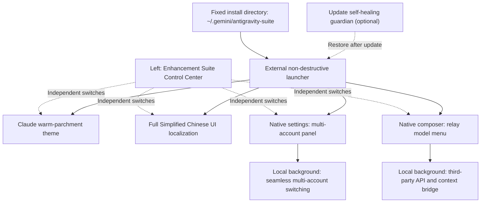

# Antigravity Enhancement Suite

<p align="center">
  <a href="./README.en.md"><b>English</b></a> &nbsp;|&nbsp; <a href="./README.md">简体中文</a>
</p>

<p align="center">
  <strong>Claude-inspired parchment theme · Simplified Chinese localization · Google multi-account hot switching · Seamless relay API switching · Independent modules</strong>
</p>

<p align="center">
  
  
  
  <a href="./LICENSE"></a>
</p>

<p align="center">
  
  <br />
  <sub>▲ Light home screen in the current release; the control center sits above “Connect Relay API” on the left.</sub>
</p>

---

## 📖 Overview

**Antigravity Enhancement Suite** is an all-in-one open-source enhancement toolkit for the **Google Antigravity 2.0 desktop app on Windows**. Without modifying or damaging the official `app.asar`, it uses an external, non-destructive bootstrap and a local background service to add four practical capabilities:

**All four modules can now be enabled independently.** Choose the modules you need during installation, then use **Enhancement Suite Control Center** on the left (above **Connect Relay API**) to toggle the Claude skin, Chinese localization, multi-account switching, and API relay separately. You can keep the official colors with Chinese-only localization, or keep the English UI and use only the account or API modules. The update self-healing scheduled task is optional and disabled by default.

1. 🎨 **Claude-inspired parchment theme (`antigravity-claude-skin`)**
   - Recreates Claude's signature **warm parchment white (`#FAF9F5`)** and **warm charcoal dark (`#1F1E1D`)** palettes, replacing harsh cool-white light.
   - **Offline humanist serif typography**: bundles `Source Serif 4` and a Chinese serif companion, giving you **crisp modern questions and warm, book-like AI answers**.
2. 🇨🇳 **Full Simplified Chinese localization (`antigravity-claude-skin/i18n`)**
   - Builds on [`Silas-02/antigravity-desktop-cn`](https://github.com/Silas-02/antigravity-desktop-cn) and adds the latest Antigravity v2.22.0+ strings (**2,126+ translation rules**).
   - Covers the **main UI, settings, top menus, context menus, and system tray menus**, while protecting code blocks, terminals, and user input from being translated.
3. 👥 **Google multi-account hot switching and quota view (`antigravity-account-switcher`)**
   - Adds visual account cards to the native **Settings → Account** page and the right sidebar panel.
   - **Quick switching**: use the account capsule next to the composer to select a saved account or refresh model quotas; switching usually keeps the current window open, with timing depending on the background service and network.
   - **License preflight**: if the target account has no Antigravity license, the suite warns you and keeps the current account instead of dropping you back to onboarding.
4. 🔌 **Seamless third-party API / relay model switching (`antigravity-model-switcher`)**
   - Supports **OpenAI-compatible** and **Anthropic Messages** endpoints, with provider presets, shared base URLs and keys, and multi-select batch import after fetching a model list.
   - **Use it directly in the native composer**: pick a relay model from the composer's model menu; supported models expose a reasoning-effort submenu whose options depend on the protocol and model.
   - **Mix models in one conversation**: switch between official and relay models, bridge local history and context, and keep agent tools such as file read/write, code search, and command execution. Actual behavior still depends on the provider's API capabilities, context window, and limits.

---

## ✨ Current UI and New Features

> The images below use the current desktop layout and production suite components in an isolated preview. Accounts, names, providers, chats, quotas, and token numbers are fictional examples; no real personal data or API keys are included. Test counts and usage numbers are not real measurements.

The three animations are recorded at **20 fps**, with static duplicate frames merged to reduce file size while preserving on-screen timing. High-resolution stills can be expanded.

### 1. Left control center: four independent module switches

Click **Enhancement Suite Control Center** on the left to manage the skin, localization, multi-account, and API modules. The panel also provides theme selection, a custom welcome name, reply font and size, quota display, token usage, low-quota reminders, and an optional self-healing guardian. Settings are saved locally; Chinese-only localization can keep the official colors.

<p align="center">
  
</p>

### 2. Warm white / warm charcoal themes and welcome message (animation)

Use the control center to choose Light, Dark, or Follow system. The welcome message uses the selected appearance typography, and the orange Antigravity mark floats gently. The saved skin switch and theme mode persist across restarts; turning the skin off keeps the official appearance.

<p align="center">
  
</p>

<details>
<summary>View the dark-theme high-resolution screenshot</summary>
<p align="center">
  
</p>
</details>

### 3. Shared provider keys and multi-model batch import

Open model management from **Connect Relay API** on the left. Choose a provider preset and enter its base URL and key; the provider profile is saved and reused by multiple models. Changing a provider key does not require editing each model separately.

<p align="center">
  
</p>

After fetching models from a provider, select multiple models and import them at once. Providers that do not expose a model list can still be configured manually.

<p align="center">
  
</p>

### 4. Composer model switching and reasoning effort (animation)

Official and relay models appear in the same model menu. Hovering a relay model that supports reasoning effort opens a submenu; moving to another model closes it. Each model stores its own effort setting; whether the provider accepts the parameter depends on its API.

<p align="center">
  
</p>

<details>
<summary>View the model-menu high-resolution screenshot</summary>
<p align="center">
  
</p>
</details>

### 5. Account quota capsule and quick-switch menu

A compact current-account capsule sits at the bottom-right of the composer. It compares the current model's weekly and 5-hour quotas, shows the lower remaining one first, and labels it “Weekly” or “5h”; ties show the weekly quota. Click it to open accounts, quota bars, and a refresh action. Quota display and low-quota reminders can be disabled independently; below 10%, the suite suggests a switch but lets you decide.

<p align="center">
  
</p>

The full account settings page still provides the account list, per-model quotas, account addition, and switching. The demo below uses two fictional accounts and never logs in or switches a real account; demo speed does not represent real switching time.

<p align="center">
  
</p>

<details>
<summary>View the native account settings high-resolution screenshot</summary>
<p align="center">
  
</p>
</details>

### 6. Native relay conversation and token table

Relay replies show reasoning content and tool execution state returned by the API. After enabling **Relay API Token Usage**, the area below **Connect Relay API** shows input, output, and total tokens for the current turn and the conversation. **Only relay API usage is recorded; official models are excluded.** If an API returns no usage, the table shows “—” and the reason; partial data is marked.

<p align="center">
  
</p>

---

## 🏗️ How It Works and Architecture



> 💡 **About the local background service**: the suite runs a lightweight local service on your own machine (bound to the loopback address `127.0.0.1:19823`) to handle account switching and API forwarding between the UI and local configuration files. Every installation uses this standard loopback address; no port is exposed to an external server.

---

## 🔒 Privacy and Data Safety

- **Accounts and keys stay local**: the runtime installs to `~/.gemini/antigravity-suite/`, with account and model data under each module's `data/` directory. Models share an API key per provider, and the UI only shows masked keys. Configuration JSON is not encrypted and should be protected like a credential file; when you request a model or sign in, the necessary data is sent to the API provider you selected or to Google.
- **No external data collection**: this open-source project contains no analytics or telemetry code.
- **Repository safeguards**: `.gitignore` excludes all personal configuration files (`data/*.json`), chat bridge caches, and backup directories. The repository only contains blank, sanitized templates: [`accounts.example.json`](./antigravity-account-switcher/data/accounts.example.json) and [`models.example.json`](./antigravity-model-switcher/data/models.example.json).

---

## 🚀 Quick Start (One-Click Install)

### 1. Requirements
- **OS**: Windows 10 / 11 (64-bit)
- **Runtime**: [Node.js](https://nodejs.org/) **22 or newer**
- **Target app**: Google Antigravity desktop client installed

### 2. Download and install

Download the [repository ZIP](https://github.com/Chenxuan-Xie/antigravity-enhancement-suite/archive/refs/heads/main.zip), extract it, and double-click **`双击一键安装.cmd`**. Choose the modules you need and install. The installer copies the runtime to a fixed application-data directory; **after a successful install, the downloaded or cloned source folder can be moved or deleted**.

You can also install with PowerShell:

```powershell
git clone https://github.com/Chenxuan-Xie/antigravity-enhancement-suite.git
cd antigravity-enhancement-suite

# Open the visual module selector
powershell -ExecutionPolicy Bypass -File .\install-all.ps1

# Chinese localization only, keep official colors, no guardian task
powershell -ExecutionPolicy Bypass -File .\install-all.ps1 -Modules i18n -NoUi

# Accounts and API only, with update self-healing
powershell -ExecutionPolicy Bypass -File .\install-all.ps1 -Modules accounts,api -EnableGuardian -NoUi
```

**One-line download and launch (PowerShell):**

```powershell
& { $installer = Join-Path $env:TEMP 'agy-suite-install.ps1'; Invoke-WebRequest 'https://raw.githubusercontent.com/Chenxuan-Xie/antigravity-enhancement-suite/main/install-online.ps1' -OutFile $installer; powershell -NoProfile -ExecutionPolicy Bypass -File $installer }
```

`-RuntimeDir` selects a fixed runtime directory, for example `D:\AppsData\antigravity-suite`; `-ConfigDir` selects the Antigravity plugin configuration directory. Use the same `-RuntimeDir` for later updates or uninstalling a custom installation.

> 📌 **If Antigravity is installed in a custom location**, pass the folder containing `Antigravity.exe` with `-AntigravityDir`:
> ```powershell
> powershell -ExecutionPolicy Bypass -File .\install-all.ps1 -AntigravityDir "D:\YourCustomPath\Antigravity"
> ```

**The installer performs these steps automatically**:
1. Detects the local Antigravity installation directory;
2. Copies the core into the fixed runtime directory and points plugins, launchers, MCP, and the optional guardian at it; reinstalling preserves accounts, models, and chat data;
3. Enables the selected plugins and UI modules and writes the external launcher while leaving the official ASAR untouched;
4. Loads the UI when the app is idle and CDP is available, without refreshing the chat; native menu and window-launch hook upgrades take full effect on the next app start; installation and re-injection wait while you are generating;
5. Registers a scheduled task and startup entry only when update self-healing is selected; otherwise the local backend starts with the app and exits when the app closes. If self-healing is off and an official update removes the launcher, run the installer again.

With update self-healing enabled, the guardian re-detects the running Antigravity installation or the location targeted by the desktop shortcut. Even if the directory changes after an update and the old version directory still exists, it restores the external launcher at the new location and keeps the uninstall manifest in sync. Official sign-in and the ASAR file remain unchanged.

The Windows desktop entry reads the current system proxy each time it opens so the local chat UI can bypass the proxy. It does not store proxy node IPs or change system proxy settings. If an official update replaces the shortcut, the enabled guardian restores the entry; uninstalling restores the original shortcut.

---

## 📚 Usage Guide

### 1. Claude-inspired two-tone skin and Simplified Chinese localization (`antigravity-claude-skin`)

1. **Switch skins in the control center (Light / Dark / Follow system)**:
   - Open **Enhancement Suite Control Center → Appearance & Welcome** on the left and choose one of the three modes in the **Switch skin** dropdown. The **Claude skin** switch at the top controls whether the suite skin is used:
     - **☀️ Light (parchment `#FAF9F5`)**: Claude Desktop's signature warm parchment canvas with caramel-terracotta accents;
     - **🌙 Dark (warm charcoal `#1F1E1D`)**: Claude Desktop's classic warm-charcoal canvas (sidebar `#161514`, cards `#282725`, off-white text `#ECE9E2`), avoiding harsh pure black and glare;
     - **💻 Follow system**: listens to the Windows 10/11 light/dark setting and switches in real time, including the native window controls.
2. **Set a custom home greeting name**:
   - A new chat shows `Good morning`, `Good afternoon`, or `Good evening` based on the time.
   - Enter a name under **Home greeting name** in the left control center; it saves instantly. Clearing it restores the default, and the Antigravity mark remains. When localization is off, the English greeting is used.
3. **Customize fonts, sizes, or translation entries**:
   - The control center offers **Follow theme / Book serif / Modern sans-serif** and **Small / Standard / Large** sizes without editing CSS. The greeting follows the same font, and the Antigravity mark stays orange and gently floating. Turning the skin off restores the official colors, fonts, and layout and hides the suite greeting; appearance settings are retained and restored when re-enabled.
   - Skin and theme settings persist across restarts. The app keeps the native page-loading flow; once the page is ready, the control center reads local configuration without waiting for a backend switch. With the skin off, the official appearance remains and the control-center entry is still available.
   - Windows may retain Electron-injected styles from older versions. The current release disables the old preload skin injection in memory while keeping native interfaces and leaving the official ASAR untouched. After updating, fully quit and reopen the app once; subsequent skin toggles apply immediately.
   - The Windows background language service reads the enabled system proxy and preserves explicitly configured proxy environment variables; loopback traffic bypasses the proxy. If sign-in reports an `oauth2.googleapis.com/token` timeout, confirm the proxy can reach Google, then fully quit and reopen the app. The suite does not change system proxy or global environment variables.
   - After changing source styles or dictionaries, update the fixed runtime while preserving current module switches and data:
     ```powershell
     powershell -ExecutionPolicy Bypass -File .\live-reload.ps1
     ```

---

### 2. Google multi-account hot switching (`antigravity-account-switcher`)

After enabling the account module, the suite detects the currently signed-in Google account. Use the quick menu or the full management panel:
- **Quick entry**: the account quota capsule next to the composer opens the switch menu. It shows the lower of the current model's weekly and 5-hour remaining quotas and labels the period; ties show weekly. If only one window is returned, that value is used; if no model matches, the lowest known quota is shown, and cached data is labeled “Cached”. Account status is checked every minute; the current account quota refreshes on demand at most every 5 minutes, and can be refreshed manually.
- **Low-quota reminder**: when fresh quota is below 10% or a native quota-limit message is detected, a backup-account switch button appears. The suite never switches automatically and cannot switch while generating. Reminders can be disabled in the control center.
- **Quota display switch**: **Show account quota** independently controls the compact composer capsule; turning it off hides the capsule and menu immediately while keeping account configuration. **Relay API Token Usage** and **Low-quota reminder** control the other features independently. Menus support hover and keyboard selection; failed authorization keeps cached quota and marks the account as needing reauthorization. Error toasts can be dismissed manually and disappear after 6 seconds.
- **Option 1 (recommended)**: open Antigravity **Settings (`Ctrl+,`) → Account**; the **Seamless multi-account switching** panel appears at the top.
- **Option 2**: open the **Account Switcher** plugin panel from the right sidebar.

#### Common actions:
1. **Add an account without signing out**:
   - **Browser sign-in**: click **+ Add account (browser sign-in)**, sign in to another Google account in the browser, and confirm authorization; the account is added automatically.
   - **Paste callback URL / authorization code**: if the browser does not return automatically, paste the full callback URL into the manual input field.
   - **Import a refresh token**: paste an existing Google `refresh_token` (starting with `1//`) to import an account quickly.
2. **One-click seamless switching**:
   - Click **Switch** next to the target account. The background updates credentials and restarts the language service while keeping the window and conversation; timing depends on the network and language-service startup. Stop any generation before switching.
   - Antigravity 2.28+ stores credentials under a per-account `antigravity-<credential-user-scope>` target. The suite updates both the new scoped target and the legacy `gemini:antigravity` target, and writes the target account's scope before restarting the language service, so switching does not fall back to onboarding.
3. **View remaining model quota**:
   - Click **Refresh quota** to see each account's remaining percentage and reset time per model, so you can switch before a quota runs out.

---

### 3. Seamless third-party API / relay model switching (`antigravity-model-switcher`)

Connect third-party APIs or relay services compatible with **OpenAI (`/v1/chat/completions`)** or **Anthropic / Claude (`/v1/messages`)** to the native Antigravity composer. Actual models and tool support depend on the API.

#### 1. Add your API key and models
In the add dialog, choose a provider preset: **OneAPI / NewAPI, Custom, DeepSeek, OpenRouter, SiliconFlow, OpenAI, Anthropic**. Official presets fill in the URL and protocol; for custom providers you supply the URL. Enter the key once, fetch the model list, select multiple models, and import them in a batch. Providers without a model-list endpoint can still be configured manually with a Model ID.

Later, select a **saved provider** to reuse its URL and key. Changing the selected provider's key or URL updates all associated models. Legacy configurations migrate grouped by URL, protocol, and key; records with different keys remain independent, and the original model file is backed up before migration.

Preset references: [DeepSeek docs](https://api-docs.deepseek.com/), [OpenRouter docs](https://openrouter.ai/docs/api/api-reference/models/get-models), [SiliconFlow docs](https://api-docs.siliconflow.cn/docs/userguide/quickstart), [OpenAI docs](https://developers.openai.com/api/reference/resources/chat/subresources/completions/methods/create), and [Anthropic docs](https://platform.claude.com/docs/en/api/messages/create). The actual model list and parameter pass-through depend on the provider.

Add models in either way:
- **From the left (recommended)**: click **Connect Relay API** to open model management; the composer's model menu is used to select added models.
- **From the right panel**: open the **API Model Switcher** panel in the right sidebar.
- Enter keys in the dedicated form to keep them out of chat history.

**Field reference**:
| Field | Required | Description |
| :--- | :---: | :--- |
| **Display name** | Optional | Name shown in the menu, e.g. `Claude 4.5 Sonnet (relay)` |
| **Base URL** | **Required** | Relay endpoint, e.g. `https://api.xxx.com/v1` |
| **API Key** | **Required** | Your API key (`sk-...`). After entering the URL and key, click **Fetch models from provider** to select models automatically |
| **Model ID** | **Required** | Model name used by the API, e.g. `claude-sonnet-4-5-20250929`, `gpt-5`, `deepseek-reasoner` |
| **Protocol** | Optional | Keep `Auto detect (auto)` or choose `Anthropic` / `OpenAI` manually |

#### 2. Switch models and adjust reasoning effort
- **One-click switch**: in the model menu at the bottom-left of the composer, click a relay model to switch to it; click an official model at any time to return to the official channel.
- **Per-conversation choice**: each conversation stores its own official/relay model selection; switching conversations does not overwrite another conversation's choice. New conversations inherit the most recent choice.
- **Reasoning effort**: supported models show a submenu arrow; hover to expand options such as Claude's **Default / Low / Medium / High / Max**. Options vary by protocol and model, and the choice is saved per model. Unsupported models show no effort submenu.
- **Native `/` and `@` input**: when the native menu is open, Enter only selects a menu item and never accidentally sends a relay message. A selected `/` action (browser, terminal, workflow, etc.) is executed by the official Antigravity agent. `@` files, directories, line ranges, and quotes are expanded into context readable by the third-party model; missing or binary files are marked in the context without blocking the question.
- **Same-conversation context**: local records bridge official and relay conversations so you can continue from previous messages after switching. Long conversations are still limited by the provider's context window; incompatible protocols or tools may require configuration changes based on the error.

#### 3. View token usage

Enable **Relay API Token Usage** in the control center; a table appears below **Connect Relay API** on the left with input, output, and total tokens for the current turn and the conversation. The switch takes effect immediately. **Only relay API usage is counted; official models are excluded.** Usage includes all relay tool and model requests in a task; Anthropic cached input is included in input tokens. Only data actually returned by the API is shown; empty conversations, old records, or APIs that return no usage show an explanation and “—”, with partial data marked. Costs are not estimated. Usage history is saved per conversation and shown separately when you switch conversations; the API management panel also shows cumulative usage.

Relay progress distinguishes reasoning received, output in progress, tool execution, and waiting for a response; network keep-alive does not mean the model is thinking. The default timeout is 120 seconds without an upstream response; continuous output and tool execution are not limited by a fixed turn count.

#### 4. Conversation storage and task execution

- **Local conversation retention**: relay messages are saved by conversation ID, and relay-only chats also appear in the conversation list; they remain available after switching conversations or restarting. Duplicate titles are still separate conversations, and deletion is keyed by conversation ID.
- **Streaming display**: replies, reasoning content returned by the API, and tool states are shown progressively; the stop button cancels the current task. Whether reasoning is returned depends on the provider; plain waiting is never displayed as received reasoning.
- **Continuous execution**: the tool loop has no fixed 48-turn cap and can continue until the model finishes, the user stops it, or an error occurs. Upstream timeouts, quotas, output limits, and context windows still apply; this is not unlimited context or an uninterrupted guarantee.

---

## 🛠️ Uninstall and Restore the Official App

Double-click **`双击一键卸载.cmd`**, or run the command below. If the source folder was deleted, run `uninstall-all.ps1` from the fixed runtime directory:

```powershell
powershell -ExecutionPolicy Bypass -File .\uninstall-all.ps1
```

The uninstaller:
1. Removes the startup entry and background update self-healing task;
2. Stops the local background service and removes the external launcher;
3. Restores only the suite's plugin configuration entries, preserving unrelated settings changed after installation;
4. Disables UI modules when the app is idle and reachable, fully restoring official startup behavior after restart. Accounts, keys, and conversation data in the fixed directory are retained and are not deleted by uninstalling.

---

## 📁 Repository Layout

```text
antigravity-enhancement-suite/
├── install-all.ps1                     # One-click full installer (recommended)
├── uninstall-all.ps1                   # Full uninstall and official-UI restore
├── live-reload.ps1                     # Live reload for styles, dictionaries, and frontend scripts
├── 双击一键安装.cmd / 双击一键卸载.cmd # Visual install / uninstall entry points
├── install-online.ps1                  # One-line download and install entry
├── suite/                              # Module switches, control center, fixed runtime install, regression
├── antigravity-claude-skin/            # [Module 1] Claude parchment theme + Chinese localization + guardian
├── antigravity-account-switcher/       # [Module 2] Google multi-account hot switching and quota plugin
└── antigravity-model-switcher/         # [Module 3] Third-party API relay and same-conversation context bridge
```

To maintain the screenshots, first run `node suite/tools/read-docs-templates.mjs`: it captures the current home screen, a completed chat, and the native account settings layout, removes private content from the copied DOM, and restores the original page afterward. Keep the app idle with an empty composer during capture. Then run `node suite/tools/capture-docs.mjs --animations`; it renders screenshots and three 20 fps animations from anonymized templates in an isolated Chrome / Edge instance. Encoding animations also requires Python and Pillow. The preview never calls a real relay API or switches a real account; templates and raw frames live under the git-ignored `artifacts/`. Review every image and key frame before publishing.

---

## 🙏 Credits and License

- The Simplified Chinese base dictionary references and incorporates translations from [Silas-02/antigravity-desktop-cn](https://github.com/Silas-02/antigravity-desktop-cn).
- This project is released under the [MIT License](./LICENSE). Stars, forks, and pull requests are welcome!
