# Antigravity Enhancement Suite

<p align="center">
  <strong>选择语言 · Choose language</strong>
</p>

<details name="language" open>
<summary><b>简体中文</b></summary>

<p align="center">
  <strong>Claude 书卷风换肤 · 简体中文汉化 · Google 多账号热切换 · 中转 API 同会话切换 · 按需独立启用</strong>
</p>

<p align="center">
  
  
  
  <a href="./LICENSE"></a>
</p>

<p align="center">
  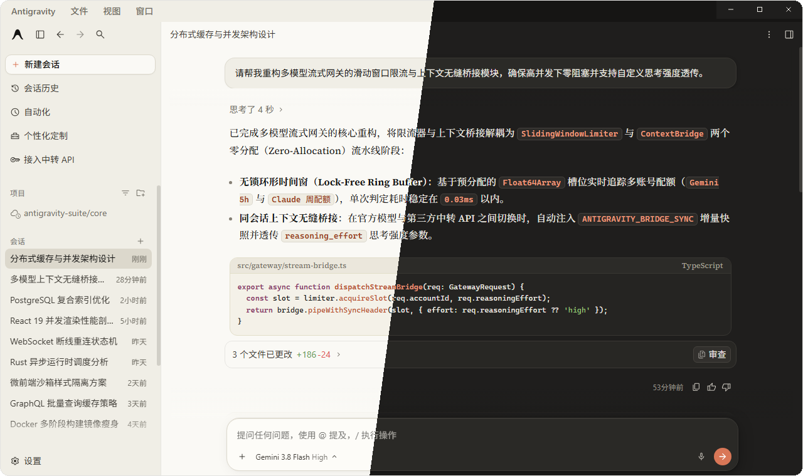
  <br />
  <sub>▲ 当前版本浅色首页；控制中心位于左侧「接入中转 API」上方。</sub>
</p>

---

## 📖 项目简介

**Antigravity Enhancement Suite** 是专为 **Google Antigravity 2.0 桌面端 (Windows)** 打造的一站式开源增强工具包。它在**不修改、不破坏官方 `app.asar` 核心文件**的前提下，通过外置无损引导与本地后台服务，为 Antigravity 提供四大实用功能：

**四项功能现在可独立启用。** 安装时勾选需要的模块；安装后点击左侧「增强套件控制中心」（位于「接入中转 API」上方），在独立面板中分别开关 Claude 皮肤、中文汉化、多账号切换和 API 中转。可以只汉化并保留官方配色，也可以保持英文界面只用账号或 API 功能。更新自愈计划任务为独立可选项，默认不启用。

1. 🎨 **Claude 书卷风主题皮肤 (`antigravity-claude-skin`)**
   - 复刻 Claude 标志性的 **羊皮纸暖白 (`#FAF9F5`)** 与 **深色暖炭黑 (`#1F1E1D`)** 双模式配色，告别刺眼冷白光。
   - **离线人文衬线排版**：内置离线 `Source Serif 4` 衬线字体与中文思源宋体混排，呈现 **“提问现代干练、AI 回答温润如书”** 的阅读体验。
2. 🇨🇳 **简体中文全量汉化 (`antigravity-claude-skin/i18n`)**
   - 融合 [`Silas-02/antigravity-desktop-cn`](https://github.com/Silas-02/antigravity-desktop-cn) 并补齐 Antigravity v2.22.0+ 最新词库（共 **2,126+ 条** 翻译规则）。
   - 完整覆盖 **主界面、设置页、顶栏菜单、右键菜单与系统托盘菜单**，同时严格保护代码块、终端与用户输入内容不被误翻。
3. 👥 **Google 多账号热切换与配额查看 (`antigravity-account-switcher`)**
   - 在原生 **「设置 -> 账号」** 页面与右侧边栏面板内嵌可视化多账号管理卡片。
   - **快捷切换**：输入框旁的账号胶囊可直接选择已保存账号、刷新模型配额；切换通常无需关闭当前窗口，耗时取决于后台服务重启与网络状态。
   - **切换前许可校验**：目标账号没有 Antigravity 使用许可时会提示并保持当前账号，不会跳回登录页。
4. 🔌 **第三方 API / 中转站模型无缝切换 (`antigravity-model-switcher`)**
   - 支持 **OpenAI 兼容接口** 与 **Anthropic Messages 接口**，提供服务商预设、共享地址与密钥，以及拉取模型后的多选批量导入。
   - **原生聊天框直接使用**：在输入框模型菜单中选择中转模型；支持的模型可展开思考强度子菜单，选项随协议和模型变化。
   - **同一对话混用**：支持官方与中转模型切换、本地历史与上下文桥接，以及文件读写、代码搜索和命令执行等 Agent 工具。接口能力、上下文长度和服务商限制仍影响实际体验。

---

## ✨ 当前界面与新增功能

> 以下图片使用当前桌面布局与套件正式组件，在隔离预览中渲染。账号、称呼、服务商、聊天、配额与 Token 数字均为虚构示例，不含真实个人信息或 API Key；测试通过数和消耗数字不是实测结果。

三段动图以 **20 帧/秒录制**，合并静止的重复帧以减少体积，保留原有停留时长；高清静态图可展开查看。

### 1. 左侧控制中心：四个模块独立开关

点击左侧「增强套件控制中心」即可管理皮肤、汉化、多账号与 API。面板还提供主题、欢迎语称呼、回复字体和字号，以及额度显示、Token 统计、低配额提醒和可选自愈守护。设置自动保存到本机；只开启汉化也可保留官方配色。

<p align="center">
  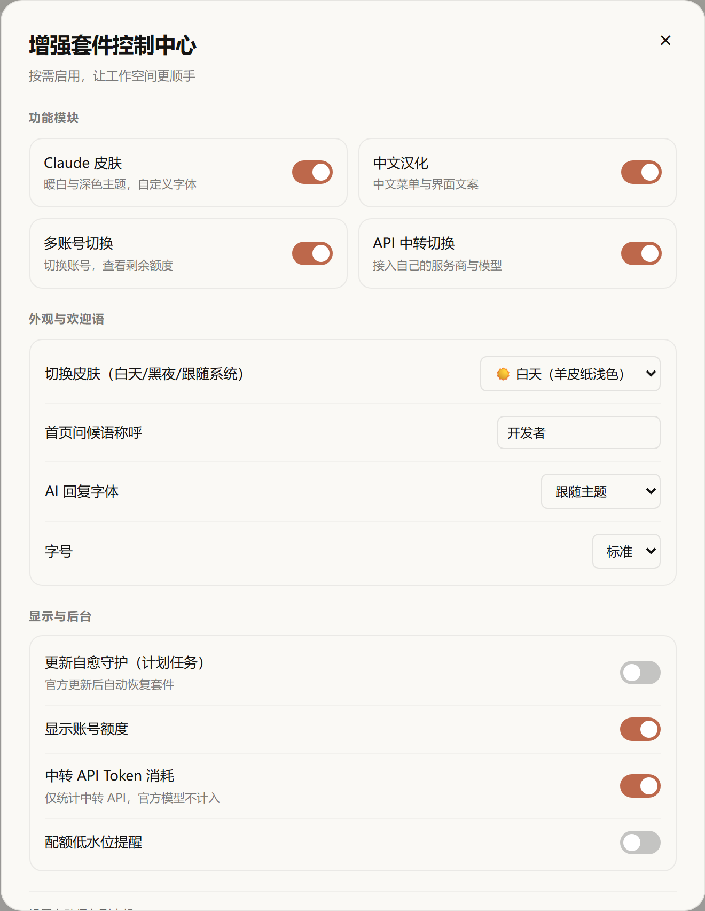
</p>

### 2. 暖白 / 暖炭黑主题与欢迎语（动态图）

控制中心可选择白天、黑夜或跟随系统。欢迎语字体同步外观设置，橙色 Antigravity 标识缓慢浮动；退出重进沿用保存的皮肤开关和主题模式，关闭皮肤保持官方外观。

<p align="center">
  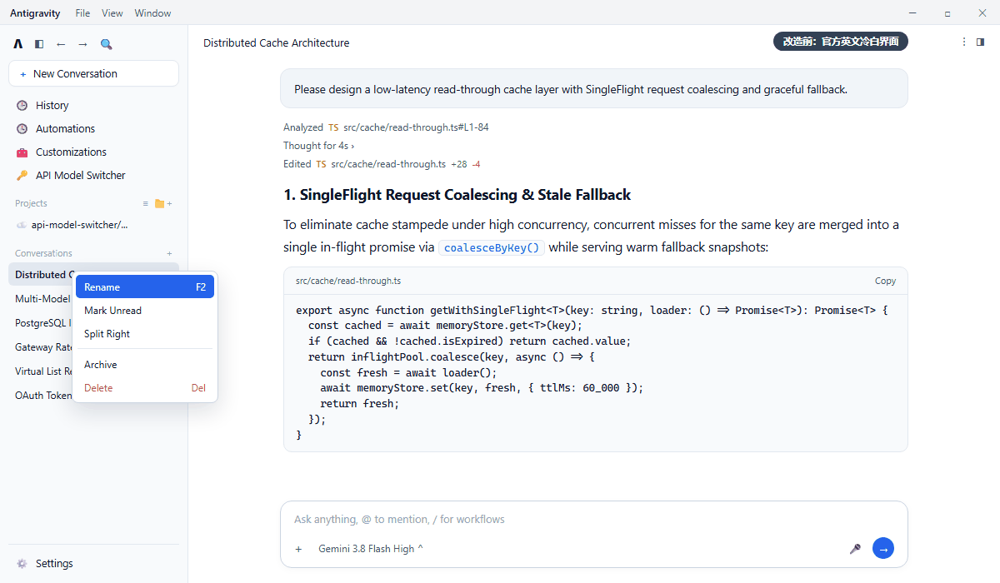
</p>

<details>
<summary>查看深色主题高清截图</summary>
<p align="center">
  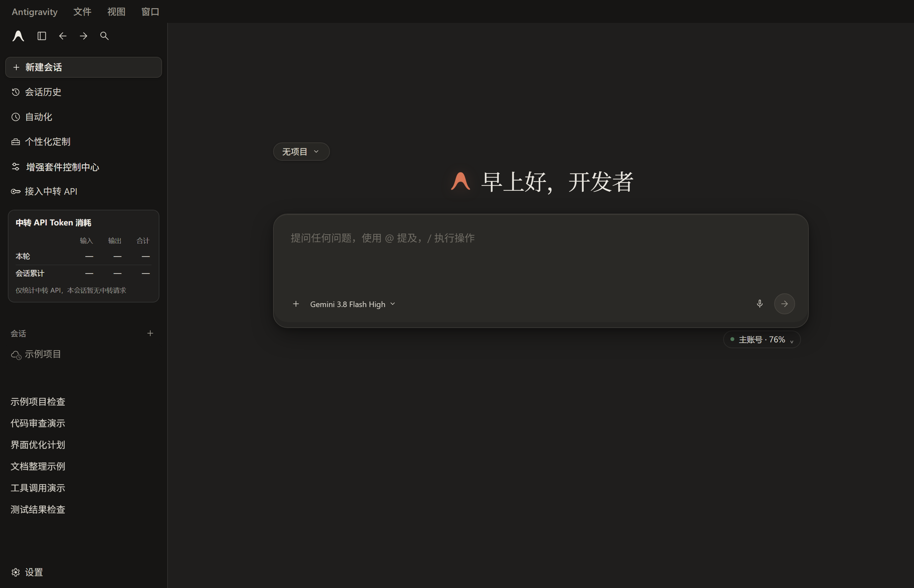
</p>
</details>

### 3. 服务商共享密钥与多模型批量导入

左侧「接入中转 API」打开模型管理。选择服务商预设、填写地址与 Key 后，可保存站点配置供多个模型复用；更换站点 Key 无需逐个修改模型。

<p align="center">
  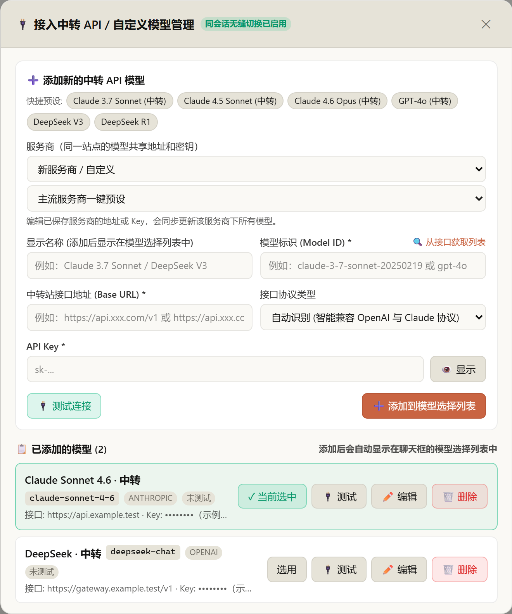
</p>

拉取站点模型后，勾选多个模型一次导入；不提供模型列表的接口仍可手动添加。

<p align="center">
  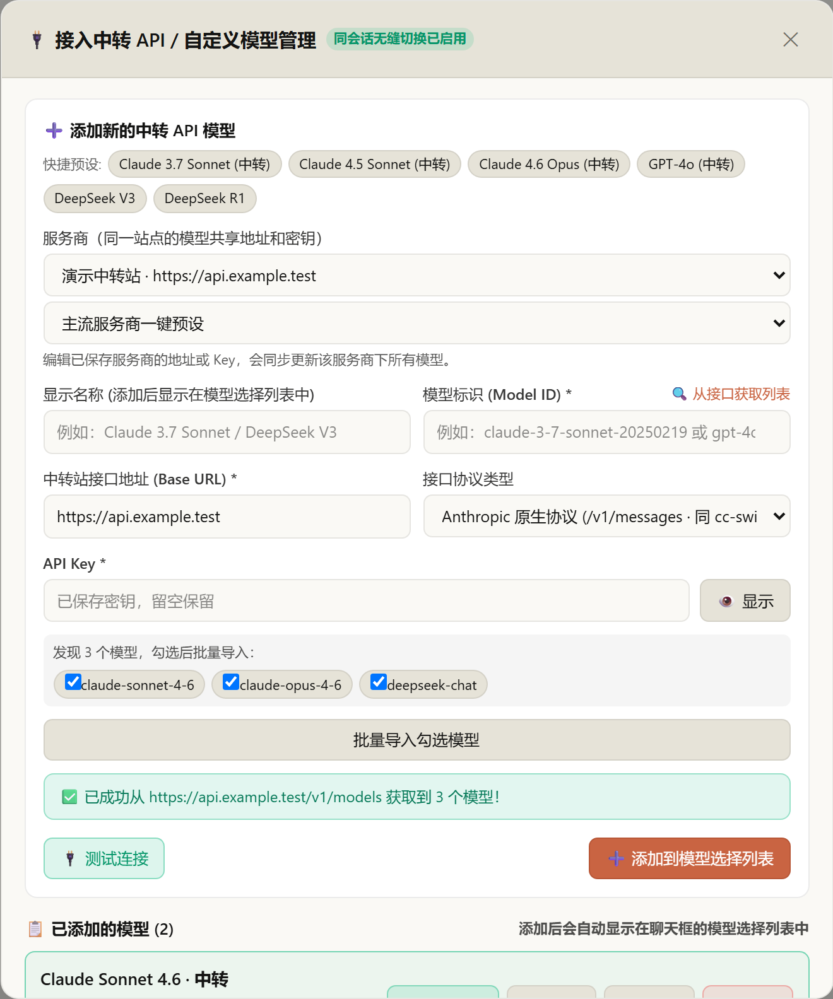
</p>

### 4. 输入框模型切换与思考强度（动态图）

官方与已添加的中转模型出现在同一个模型菜单中。悬停支持思考强度的中转模型可展开子菜单；移到其他模型时对应子菜单关闭。各模型保存自己的强度设置，接口是否接受该参数取决于服务商。

<p align="center">
  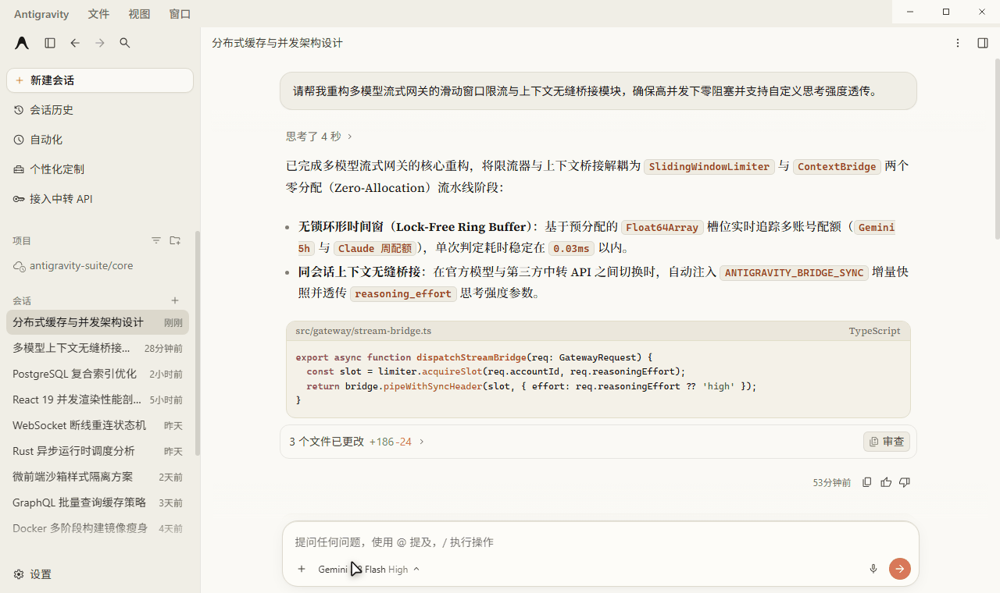
</p>

<details>
<summary>查看模型菜单高清截图</summary>
<p align="center">
  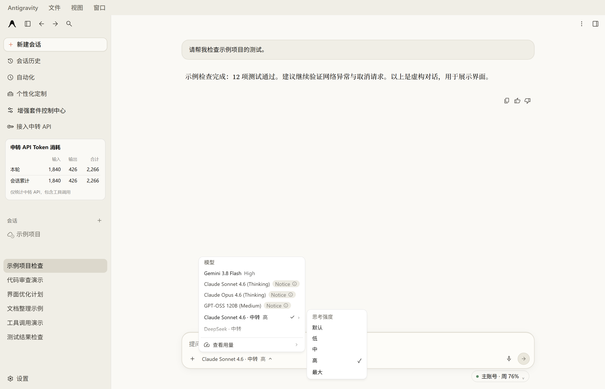
</p>
</details>

### 5. 账号额度胶囊与快捷切换菜单

输入区右下方显示紧凑的当前账号胶囊，比较当前模型的周额度和 5h 额度，优先显示剩余更低的一项，并标明「周」或「5h」；相同时显示周额度。点击展开账号、配额进度条与刷新按钮。显示额度和低配额提醒可分别关闭；低于 10% 时提供切换建议，由用户决定是否切号。

<p align="center">
  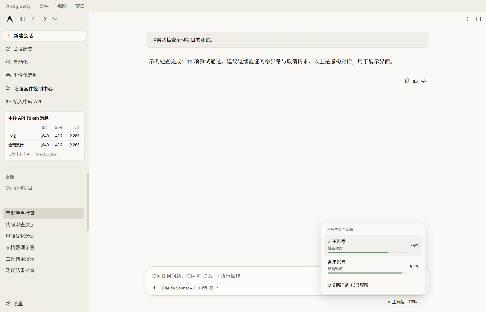
</p>

完整账号设置页仍保留账号列表、分模型配额、添加账号和切换入口。下面演示使用两个虚构账号，不会登录或切换真实账号；演示速度不代表真实切换耗时。

<p align="center">
  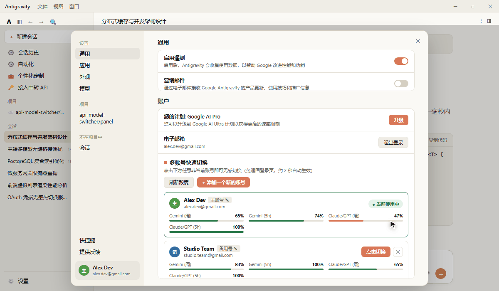
</p>

<details>
<summary>查看原生账号设置高清截图</summary>
<p align="center">
  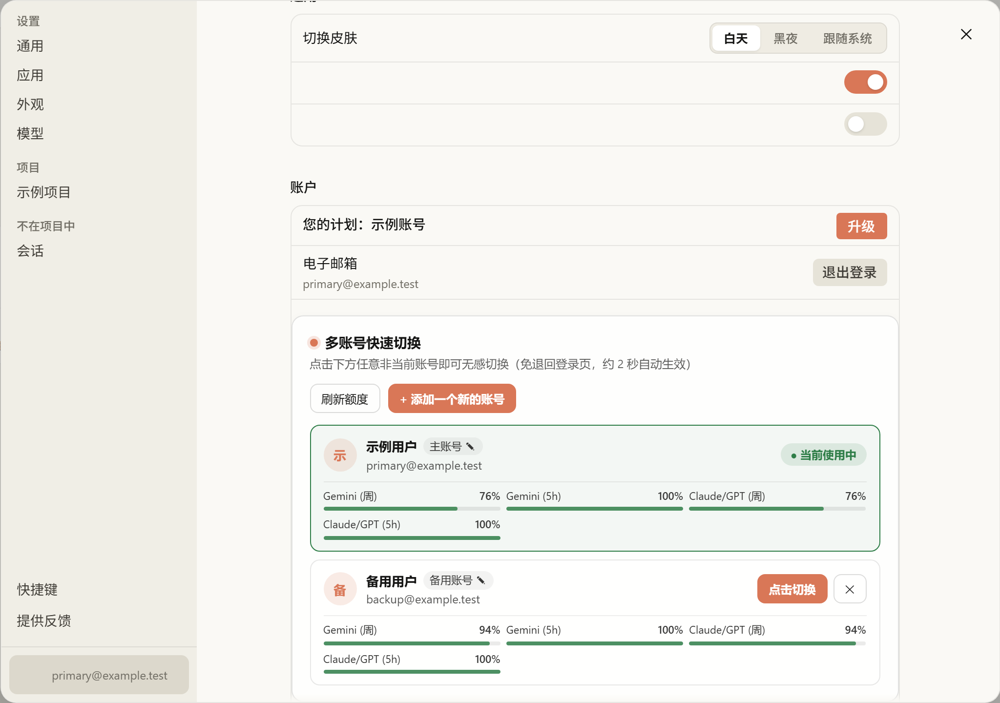
</p>
</details>

### 6. 原生中转会话与 Token 表格

中转回复展示接口返回的思考内容与工具执行状态。开启「中转 API Token 消耗」后，左侧「接入中转 API」下方展示本轮及会话累计的输入、输出和合计。**只记录中转 API，官方模型不计入**；接口未返回统计时显示「—」和原因，部分缺失会标注。

<p align="center">
  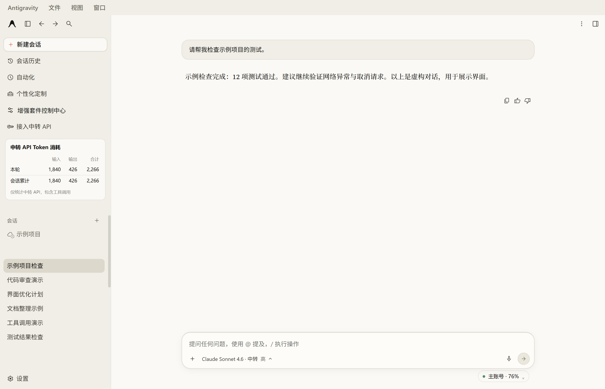
</p>

---

## 🏗️ 工作原理与架构图

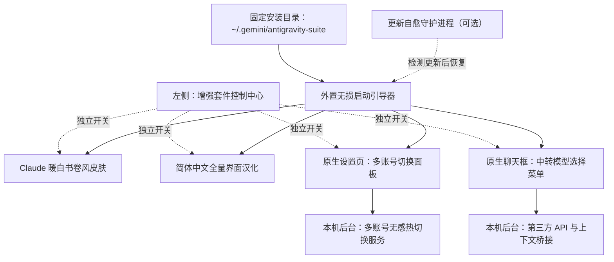

> 💡 **关于本机后台服务的说明**：套件会在您自己的电脑后台自动运行一个轻量级本地服务（监听本机回环地址 `127.0.0.1:19823`），专门负责处理界面与本地配置文件之间的账号切换和 API 转发。所有用户安装后均使用该标准本机回环地址，不会向任何外部服务器暴露端口。

---

## 🔒 隐私与数据安全说明

- **账号与密钥保存在本机**：默认安装到 `~/.gemini/antigravity-suite/`，账号与模型数据位于对应模块的 `data/` 中。模型按服务商共享 API Key，界面列表只显示掩码。配置 JSON 本身未加密，应按凭据文件保护；请求模型或登录时会按功能向您选择的 API 服务商或 Google 发送所需数据。
- **零外部数据收集**：本开源项目不包含任何统计或遥测代码。
- **仓库防呆保护**：`.gitignore` 已默认排除所有个人配置文件（`data/*.json`）、聊天桥接缓存与备份目录；仓库中仅提供空白的脱敏模板 [`accounts.example.json`](./antigravity-account-switcher/data/accounts.example.json) 与 [`models.example.json`](./antigravity-model-switcher/data/models.example.json)。

---

## 🚀 快速开始（一键安装）

### 1. 环境要求
- **操作系统**：Windows 10 / 11 (64 位)
- **基础环境**：已安装 [Node.js](https://nodejs.org/) **22 或以上版本**
- **目标软件**：已安装 Google Antigravity 桌面客户端

### 2. 下载并一键安装

下载 [仓库 ZIP](https://github.com/Chenxuan-Xie/antigravity-enhancement-suite/archive/refs/heads/main.zip) 并解压，双击 **`双击一键安装.cmd`**，勾选需要的功能后安装。安装器将运行时复制到固定应用数据目录；**成功安装后，下载或克隆的源文件夹可以移动或删除**。

也可以用 PowerShell 安装：

```powershell
git clone https://github.com/Chenxuan-Xie/antigravity-enhancement-suite.git
cd antigravity-enhancement-suite

# 打开可视化功能选择窗口
powershell -ExecutionPolicy Bypass -File .\install-all.ps1

# 只汉化，保留官方颜色；不注册自愈任务
powershell -ExecutionPolicy Bypass -File .\install-all.ps1 -Modules i18n -NoUi

# 只启用账号与 API，并选择更新自愈
powershell -ExecutionPolicy Bypass -File .\install-all.ps1 -Modules accounts,api -EnableGuardian -NoUi
```

**一行命令下载并启动安装器（PowerShell）：**

```powershell
& { $installer = Join-Path $env:TEMP 'agy-suite-install.ps1'; Invoke-WebRequest 'https://raw.githubusercontent.com/Chenxuan-Xie/antigravity-enhancement-suite/main/install-online.ps1' -OutFile $installer; powershell -NoProfile -ExecutionPolicy Bypass -File $installer }
```

`-RuntimeDir` 可指定固定安装目录，例如 `D:\AppsData\antigravity-suite`；`-ConfigDir` 可指定 Antigravity 插件配置目录。以后更新或卸载自定义安装时也传入相同的 `-RuntimeDir`。

> 📌 **如果您的 Antigravity 安装在自定义位置**，可以通过 `-AntigravityDir` 参数指定 `Antigravity.exe` 所在的文件夹路径：
> ```powershell
> powershell -ExecutionPolicy Bypass -File .\install-all.ps1 -AntigravityDir "D:\YourCustomPath\Antigravity"
> ```

**安装脚本会自动为您完成以下步骤**：
1. 自动识别本机 Antigravity 安装目录；
2. 复制核心到固定运行时目录，插件、启动器、MCP 和可选守护均指向该目录；重装保留账号、模型与聊天数据；
3. 根据勾选项启用插件和界面模块，写入外置启动器，官方 ASAR 保持不变；
4. 应用空闲且 CDP 可用时加载界面，无需刷新聊天；原生菜单与窗口启动钩子的升级在下一次应用启动时完整生效；生成期间安装和重新注入会等待用户完成任务；
5. 仅在选择更新自愈时注册计划任务与开机自启；未启用时，本机后端由应用启动，应用关闭后退出。关闭自愈后，官方更新若移除启动器，需要重新运行安装器。

启用更新自愈后，守护进程会重新识别正在运行的 Antigravity 或桌面快捷方式指向的安装位置；即使更新后目录改变、旧版本目录仍存在，也会跟随新位置恢复外置启动器，并同步卸载清单。官方登录流程和 ASAR 文件保持原样。

Windows 桌面启动入口会在每次打开时读取当前系统代理，让本机聊天界面绕过代理；不保存代理节点 IP，也不修改系统代理设置。官方更新替换快捷方式后，已启用的自愈守护会恢复该入口；卸载时恢复原快捷方式。

---

## 📚 功能使用指南

### 一、Claude 书卷双色皮肤与简体中文汉化 (`antigravity-claude-skin`)

1. **控制中心切换皮肤（白天 / 黑夜 / 跟随系统）**：
   - 点击左侧 **「增强套件控制中心」→「外观与欢迎语」**，通过 **「切换皮肤」** 下拉菜单选择三档模式；顶部「Claude 皮肤」开关控制是否使用套件皮肤：
     - **☀️ 白天（羊皮纸浅色 `#FAF9F5`）**：复刻 Claude Desktop 标志性羊皮纸暖白画布与焦糖赤陶点缀；
     - **🌙 黑夜（暖炭黑深色 `#1F1E1D`）**：复刻 Claude Desktop 经典暖炭黑深色护眼画布（侧栏 `#161514`、卡片 `#282725`、米白正文 `#ECE9E2`），彻底告别刺眼纯黑与反差眩光；
     - **💻 跟随系统**：自动监听 Windows 10/11 系统深浅色设置并实时无感切换（连同 Windows 原生右上角窗口控制栏自动同步变色）。
2. **设置专属首页问候语称呼**：
   - 新建会话首页默认根据时间显示 `早上好`、`下午好`、`晚上好`。
   - 在左侧「增强套件控制中心」的「首页问候语称呼」输入名字，实时保存；清空恢复默认称呼，修改称呼保留欢迎语左侧 Antigravity 图标。汉化关闭时使用英文问候语。
3. **自定义字体字号或翻译词条**：
   - 控制中心可选择「跟随主题 / 书卷衬线体 / 现代无衬线体」及「小 / 标准 / 大」字号，无需改 CSS。欢迎语同步字体，Antigravity 图标保持橙色与缓慢浮动。关闭皮肤恢复官方配色、字体与布局，并隐藏皮肤欢迎语；外观设置会保留，重新开启时恢复。
   - 退出重进沿用已保存的皮肤开关和主题模式。应用沿用原生页面加载流程；页面就绪后，控制中心直接读取本地配置，不等待切换后端启动。关闭皮肤时保持官方外观并保留控制中心入口。
   - 老版本安装过的窗口可能残留 Electron 直接注入的样式。新版在内存中停用旧预加载的皮肤注入，保留原生接口，不改写官方 ASAR；更新后需完整退出应用再打开一次，之后皮肤开关即时生效。
   - Windows 桌面版的后台语言服务会读取已启用的系统代理，并保留显式配置的代理环境变量；本机回环通信绕过代理。若登录错误包含 `oauth2.googleapis.com/token` 连接超时，请确认代理可访问 Google 后完整退出再打开应用。套件不改动系统代理或全局环境变量。
   - 开发者修改源码样式或词典后，以下命令将更新固定目录中的运行时，保留当前功能开关与数据：
     ```powershell
     powershell -ExecutionPolicy Bypass -File .\live-reload.ps1
     ```

---

### 二、Google 多账号热切换 (`antigravity-account-switcher`)

启用账号模块后，系统会识别您当前已登录的 Google 账号。可通过快捷菜单或完整管理面板使用：
- **快捷入口**：聊天输入框旁的账号配额胶囊，点击即可打开切换菜单；显示当前模型周额度与 5h 额度中剩余更低的一项，并标明周期，相同时显示周额度。只返回一个周期时使用已知值；无法匹配模型时显示最低已知配额，缓存数据会标注「缓存」。每分钟检查账号状态，当前账号配额按需每 5 分钟刷新，也可手动刷新。
- **低配额提醒**：新鲜配额低于 10% 或检测到原生额度限制提示时，提供备用账号切换按钮；不会自动切号，生成过程中不能切换。提醒可在控制中心关闭。
- **额度显示开关**：控制中心的「显示账号额度」独立控制输入区的紧凑账号胶囊，关闭后立即隐藏胶囊与菜单，保留账号配置。「中转 API Token 消耗」和「配额低水位提醒」分别控制其他功能。菜单支持悬停与键盘选中；授权失败保留缓存额度并标记需重新授权，错误轻提示可手动关闭且在 6 秒后自动消失。
- **方式一（推荐）**：打开 Antigravity **「设置 (`Ctrl+,`) -> 账号」**，页面顶部会直接显示 **「多账号无缝热切换」** 面板。
- **方式二**：点击窗口右侧边栏打开 **Account Switcher** 插件面板。

#### 常用操作：
1. **添加新账号（无需退出当前账号）**：
   - **浏览器登录授权**：点击 **「+ 添加新账号 (浏览器登录)」**，在弹出的浏览器页面中登录另一个 Google 账号并确认授权，即可自动添加至列表。
   - **粘贴回调链接 / 授权码**：若浏览器未自动跳回，可将授权后浏览器地址栏的完整链接粘贴到手动输入框中完成添加。
   - **导入 Refresh Token**：支持直接粘贴已有的 Google `refresh_token`（以 `1//` 开头）快速导入账号。
2. **一键无感切换**：
   - 点击目标账号右侧的 **「切换」** 按钮，后台更新当前凭据并重启后台语言服务，保留窗口与对话；完成时间取决于网络及语言服务启动状态。生成期间请先停止任务再切换。
   - Antigravity 2.28+ 会把凭据写入按账号隔离的 `antigravity-<credential-user-scope>` 目标。套件会同时更新新版 scoped 目标与旧版 `gemini:antigravity`，并在重启语言服务前写回目标账号的 scope，避免切换后跳回登录引导页。
3. **查看模型剩余配额**：
   - 点击 **「刷新配额」** 即可查看每个账号下各模型的剩余额度百分比与重置时间，方便在额度用尽时及时切换备用账号。

---

### 三、第三方 API / 中转站模型无缝切换 (`antigravity-model-switcher`)

支持将兼容 **OpenAI (`/v1/chat/completions`)** 或 **Anthropic / Claude (`/v1/messages`)** 协议的第三方 API 或中转站接入 Antigravity 原生聊天框，具体模型与工具能力取决于接口。

#### 1. 添加您的 API Key 与模型
先在添加弹窗选择服务商预设：**OneAPI / NewAPI、自定义、DeepSeek、OpenRouter、硅基流动、OpenAI、Anthropic**。官方预设填写地址与协议，自定义站点的地址由用户提供。填写一次 Key，拉取模型列表后勾选多个模型并批量导入；不提供模型列表的站点仍可手动填写 Model ID。

之后选择「已保存服务商」即可复用地址和密钥；修改所选服务商的 Key 或地址会同步更新关联模型。旧版配置按地址、协议和密钥分组迁移，使用不同密钥的记录保持独立，迁移前保留原模型文件备份。

预设地址参考 [DeepSeek 文档](https://api-docs.deepseek.com/)、[OpenRouter 文档](https://openrouter.ai/docs/api/api-reference/models/get-models)、[硅基流动文档](https://api-docs.siliconflow.cn/docs/userguide/quickstart)、[OpenAI 文档](https://developers.openai.com/api/reference/resources/chat/subresources/completions/methods/create) 和 [Anthropic 文档](https://platform.claude.com/docs/en/api/messages/create)。实际模型列表与参数透传能力取决于所选服务商。
您可以通过以下任意一种方式添加模型：
- **在左侧添加（推荐）**：点击 **「接入中转 API」** 打开模型管理；输入框的模型菜单用于选择已添加的模型。
- **在右侧面板添加**：打开右侧边栏的 **API Model Switcher** 面板进行配置。
- 密钥建议在专用表单中填写，避免进入聊天历史。

**填写说明**：
| 配置项 | 是否必填 | 填写说明 |
| :--- | :---: | :--- |
| **显示名称** | 选填 | 在菜单中展示的名称，例如 `Claude 4.5 Sonnet (中转)` |
| **接口地址 (`Base URL`)** | **必填** | 中转站地址，例如 `https://api.xxx.com/v1` |
| **API Key** | **必填** | 您的 API 密钥（`sk-...`）。填好地址和密钥后，可点击 **「从站点拉取模型列表」** 自动选择模型 |
| **模型 ID (`Model ID`)** | **必填** | 接口实际调用的模型名，如 `claude-sonnet-4-5-20250929`、`gpt-5`、`deepseek-reasoner` |
| **协议类型** | 选填 | 默认选 `自动识别 (auto)` 即可，也可手动指定 `Anthropic` 或 `OpenAI` |

#### 2. 切换模型与调节思考强度
- **一键切换**：在聊天输入框左下角的模型菜单中，点击您添加的中转模型即可切换过去；随时点击官方模型即可切回官方通道。
- **按会话记住选择**：每个对话独立保存自己的官方/中转模型选择，切换对话不会互相覆盖；新建会话沿用最近一次选择。
- **调节思考强度**：支持的模型名称右侧显示子菜单箭头，悬停展开可用选项，例如 Claude 的「默认 / 低 / 中 / 高 / 最大」。选项随协议、模型变化，选择结果按模型保存；不支持的模型不显示强度子菜单。
- **原生 `/` 与 `@` 输入**：输入 `/` 或 `@` 打开原生菜单时，回车只用于选择菜单项，不会误发成中转消息；选中 `/` 动作（浏览器、终端、工作流等）后由 Antigravity 官方 Agent 执行。`@` 文件、目录、行号范围与引用块会自动展开为第三方模型可读的上下文；文件缺失或为二进制时会在上下文中标注，不阻塞提问。
- **同会话上下文衔接**：通过本地记录桥接官方与中转对话，切换后继续使用前文。长对话仍受服务商上下文窗口限制，协议或工具不兼容时需要按错误提示调整配置。

#### 3. 查看 Token 消耗

在控制中心开启「中转 API Token 消耗」，左侧「接入中转 API」下方出现统计表，展示本轮和会话累计的输入、输出与合计 Token；开关即时生效。**仅统计中转 API，官方模型不计入。** 统计包含一次任务中的各次中转工具与模型请求，Anthropic 缓存输入也计入输入数。只显示接口实际返回的数据；空会话、旧记录或不返回统计的接口会显示说明和「—」，部分缺失会标明，不估算费用。历史统计随会话保存，切换会话显示各自的数据；API 管理面板也可查看累计统计。

中转请求的运行提示区分收到思考内容、正在输出、执行工具和等待响应；网络保活不代表模型在思考。默认按连续 120 秒无上游响应超时，持续输出和工具执行不受固定轮数上限影响。

#### 4. 会话保存与任务运行

- **本地会话留存**：中转消息按会话标识保存，纯中转聊天也会进入会话列表；切换会话或退出重进后可继续查看。重复标题仍是不同会话，删除按会话标识处理。
- **流式过程展示**：逐步显示回复、接口返回的思考内容与工具状态；停止按钮可取消当前任务。是否返回思考内容由服务商决定，不会将单纯等待显示为已收到思考。
- **持续执行**：工具循环没有固定 48 轮上限，可持续到模型完成、用户停止或遇到错误。上游超时、额度、输出长度和上下文窗口等限制仍然存在，不代表无限上下文或永远不中断。

---

## 🛠️ 一键卸载与恢复官方原版

双击 **`双击一键卸载.cmd`**；也可以运行以下命令。源文件夹已删除时，直接运行固定安装目录中的 `uninstall-all.ps1`：

```powershell
powershell -ExecutionPolicy Bypass -File .\uninstall-all.ps1
```

卸载脚本会：
1. 移除开机自启项与后台更新自愈计划任务；
2. 停止后台本地服务并清理外置启动器；
3. 仅还原套件的插件配置项，保留安装后修改的无关设置；
4. 应用空闲且可连接时关闭界面模块，重启后完整恢复官方启动行为。固定目录中的账号、密钥与会话数据保留，不会随卸载删除。

---

## 📁 目录结构

```text
antigravity-enhancement-suite/
├── install-all.ps1                     # 一键全量安装脚本（推荐入口）
├── uninstall-all.ps1                   # 一键完整卸载与还原官方界面脚本
├── live-reload.ps1                     # 样式、词条与前端脚本实时热更新工具
├── 双击一键安装.cmd / 双击一键卸载.cmd # 可视化安装入口
├── install-online.ps1                  # 一行下载安装入口
├── suite/                              # 独立开关、控制中心、固定运行时安装与回归
├── antigravity-claude-skin/            # [模块一] Claude 暖白书卷风皮肤 + 简体中文全量汉化 + 更新自愈守护
├── antigravity-account-switcher/       # [模块二] Google 多账号一键无感热切换与配额查看插件
└── antigravity-model-switcher/         # [模块三] 第三方 API / 中转站无缝切换与同会话上下文衔接插件
```

维护图片时先运行 `node suite/tools/read-docs-templates.mjs`：采集当前首页、已完成的聊天和原生账号设置布局，在复制的 DOM 中去除私人内容，结束恢复原页面。采集期间请保持应用空闲、输入框为空。再运行 `node suite/tools/capture-docs.mjs --animations`，只使用匿名模板，在独立 Chrome / Edge 中渲染截图和三段 20 帧/秒动图；编码动图还需要 Python 与 Pillow。预览不会调用真实中转 API 或切换真实账号，模板与原始帧位于忽略提交的 `artifacts/`。发布前仍应逐张检查图片和关键帧。

---

## 🙏 致谢与开源协议

- 简体中文基础词库参考并融合了 [Silas-02/antigravity-desktop-cn](https://github.com/Silas-02/antigravity-desktop-cn) 项目的翻译贡献。
- 本项目采用 [MIT License](./LICENSE) 开源协议，欢迎 Star、Fork 与提交 PR！

</details>

---

<details name="language">
<summary><b>English</b></summary>

<p align="center">
  <strong>Claude-inspired parchment theme · Simplified Chinese localization · Google multi-account hot switching · Seamless relay API switching · Independent modules</strong>
</p>

<p align="center">
  
  
  
  <a href="./LICENSE"></a>
</p>

<p align="center">
  
  <br />
  <sub>▲ Light home screen in the current release; the control center sits above “Connect Relay API” on the left.</sub>
</p>

---

## 📖 Overview

**Antigravity Enhancement Suite** is an all-in-one open-source enhancement toolkit for the **Google Antigravity 2.0 desktop app on Windows**. Without modifying or damaging the official `app.asar`, it uses an external, non-destructive bootstrap and a local background service to add four practical capabilities:

**All four modules can now be enabled independently.** Choose the modules you need during installation, then use **Enhancement Suite Control Center** on the left (above **Connect Relay API**) to toggle the Claude skin, Chinese localization, multi-account switching, and API relay separately. You can keep the official colors with Chinese-only localization, or keep the English UI and use only the account or API modules. The update self-healing scheduled task is optional and disabled by default.

1. 🎨 **Claude-inspired parchment theme (`antigravity-claude-skin`)**
   - Recreates Claude's signature **warm parchment white (`#FAF9F5`)** and **warm charcoal dark (`#1F1E1D`)** palettes, replacing harsh cool-white light.
   - **Offline humanist serif typography**: bundles `Source Serif 4` and a Chinese serif companion, giving you **crisp modern questions and warm, book-like AI answers**.
2. 🇨🇳 **Full Simplified Chinese localization (`antigravity-claude-skin/i18n`)**
   - Builds on [`Silas-02/antigravity-desktop-cn`](https://github.com/Silas-02/antigravity-desktop-cn) and adds the latest Antigravity v2.22.0+ strings (**2,126+ translation rules**).
   - Covers the **main UI, settings, top menus, context menus, and system tray menus**, while protecting code blocks, terminals, and user input from being translated.
3. 👥 **Google multi-account hot switching and quota view (`antigravity-account-switcher`)**
   - Adds visual account cards to the native **Settings → Account** page and the right sidebar panel.
   - **Quick switching**: use the account capsule next to the composer to select a saved account or refresh model quotas; switching usually keeps the current window open, with timing depending on the background service and network.
   - **License preflight**: if the target account has no Antigravity license, the suite warns you and keeps the current account instead of dropping you back to onboarding.
4. 🔌 **Seamless third-party API / relay model switching (`antigravity-model-switcher`)**
   - Supports **OpenAI-compatible** and **Anthropic Messages** endpoints, with provider presets, shared base URLs and keys, and multi-select batch import after fetching a model list.
   - **Use it directly in the native composer**: pick a relay model from the composer's model menu; supported models expose a reasoning-effort submenu whose options depend on the protocol and model.
   - **Mix models in one conversation**: switch between official and relay models, bridge local history and context, and keep agent tools such as file read/write, code search, and command execution. Actual behavior still depends on the provider's API capabilities, context window, and limits.

---

## ✨ Current UI and New Features

> The images below use the current desktop layout and production suite components in an isolated preview. Accounts, names, providers, chats, quotas, and token numbers are fictional examples; no real personal data or API keys are included. Test counts and usage numbers are not real measurements.

The three animations are recorded at **20 fps**, with static duplicate frames merged to reduce file size while preserving on-screen timing. High-resolution stills can be expanded.

### 1. Left control center: four independent module switches

Click **Enhancement Suite Control Center** on the left to manage the skin, localization, multi-account, and API modules. The panel also provides theme selection, a custom welcome name, reply font and size, quota display, token usage, low-quota reminders, and an optional self-healing guardian. Settings are saved locally; Chinese-only localization can keep the official colors.

<p align="center">
  
</p>

### 2. Warm white / warm charcoal themes and welcome message (animation)

Use the control center to choose Light, Dark, or Follow system. The welcome message uses the selected appearance typography, and the orange Antigravity mark floats gently. The saved skin switch and theme mode persist across restarts; turning the skin off keeps the official appearance.

<p align="center">
  
</p>

<details>
<summary>View the dark-theme high-resolution screenshot</summary>
<p align="center">
  
</p>
</details>

### 3. Shared provider keys and multi-model batch import

Open model management from **Connect Relay API** on the left. Choose a provider preset and enter its base URL and key; the provider profile is saved and reused by multiple models. Changing a provider key does not require editing each model separately.

<p align="center">
  
</p>

After fetching models from a provider, select multiple models and import them at once. Providers that do not expose a model list can still be configured manually.

<p align="center">
  
</p>

### 4. Composer model switching and reasoning effort (animation)

Official and relay models appear in the same model menu. Hovering a relay model that supports reasoning effort opens a submenu; moving to another model closes it. Each model stores its own effort setting; whether the provider accepts the parameter depends on its API.

<p align="center">
  
</p>

<details>
<summary>View the model-menu high-resolution screenshot</summary>
<p align="center">
  
</p>
</details>

### 5. Account quota capsule and quick-switch menu

A compact current-account capsule sits at the bottom-right of the composer. It compares the current model's weekly and 5-hour quotas, shows the lower remaining one first, and labels it “Weekly” or “5h”; ties show the weekly quota. Click it to open accounts, quota bars, and a refresh action. Quota display and low-quota reminders can be disabled independently; below 10%, the suite suggests a switch but lets you decide.

<p align="center">
  
</p>

The full account settings page still provides the account list, per-model quotas, account addition, and switching. The demo below uses two fictional accounts and never logs in or switches a real account; demo speed does not represent real switching time.

<p align="center">
  
</p>

<details>
<summary>View the native account settings high-resolution screenshot</summary>
<p align="center">
  
</p>
</details>

### 6. Native relay conversation and token table

Relay replies show reasoning content and tool execution state returned by the API. After enabling **Relay API Token Usage**, the area below **Connect Relay API** shows input, output, and total tokens for the current turn and the conversation. **Only relay API usage is recorded; official models are excluded.** If an API returns no usage, the table shows “—” and the reason; partial data is marked.

<p align="center">
  
</p>

---

## 🏗️ How It Works and Architecture

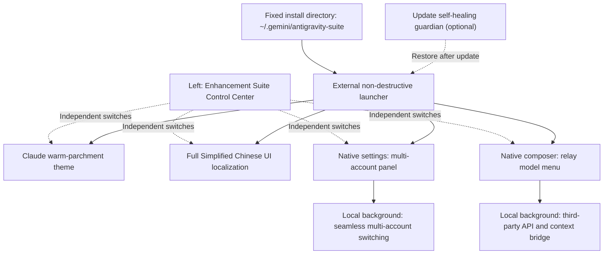

> 💡 **About the local background service**: the suite runs a lightweight local service on your own machine (bound to the loopback address `127.0.0.1:19823`) to handle account switching and API forwarding between the UI and local configuration files. Every installation uses this standard loopback address; no port is exposed to an external server.

---

## 🔒 Privacy and Data Safety

- **Accounts and keys stay local**: the runtime installs to `~/.gemini/antigravity-suite/`, with account and model data under each module's `data/` directory. Models share an API key per provider, and the UI only shows masked keys. Configuration JSON is not encrypted and should be protected like a credential file; when you request a model or sign in, the necessary data is sent to the API provider you selected or to Google.
- **No external data collection**: this open-source project contains no analytics or telemetry code.
- **Repository safeguards**: `.gitignore` excludes all personal configuration files (`data/*.json`), chat bridge caches, and backup directories. The repository only contains blank, sanitized templates: [`accounts.example.json`](./antigravity-account-switcher/data/accounts.example.json) and [`models.example.json`](./antigravity-model-switcher/data/models.example.json).

---

## 🚀 Quick Start (One-Click Install)

### 1. Requirements
- **OS**: Windows 10 / 11 (64-bit)
- **Runtime**: [Node.js](https://nodejs.org/) **22 or newer**
- **Target app**: Google Antigravity desktop client installed

### 2. Download and install

Download the [repository ZIP](https://github.com/Chenxuan-Xie/antigravity-enhancement-suite/archive/refs/heads/main.zip), extract it, and double-click **`双击一键安装.cmd`**. Choose the modules you need and install. The installer copies the runtime to a fixed application-data directory; **after a successful install, the downloaded or cloned source folder can be moved or deleted**.

You can also install with PowerShell:

```powershell
git clone https://github.com/Chenxuan-Xie/antigravity-enhancement-suite.git
cd antigravity-enhancement-suite

# Open the visual module selector
powershell -ExecutionPolicy Bypass -File .\install-all.ps1

# Chinese localization only, keep official colors, no guardian task
powershell -ExecutionPolicy Bypass -File .\install-all.ps1 -Modules i18n -NoUi

# Accounts and API only, with update self-healing
powershell -ExecutionPolicy Bypass -File .\install-all.ps1 -Modules accounts,api -EnableGuardian -NoUi
```

**One-line download and launch (PowerShell):**

```powershell
& { $installer = Join-Path $env:TEMP 'agy-suite-install.ps1'; Invoke-WebRequest 'https://raw.githubusercontent.com/Chenxuan-Xie/antigravity-enhancement-suite/main/install-online.ps1' -OutFile $installer; powershell -NoProfile -ExecutionPolicy Bypass -File $installer }
```

`-RuntimeDir` selects a fixed runtime directory, for example `D:\AppsData\antigravity-suite`; `-ConfigDir` selects the Antigravity plugin configuration directory. Use the same `-RuntimeDir` for later updates or uninstalling a custom installation.

> 📌 **If Antigravity is installed in a custom location**, pass the folder containing `Antigravity.exe` with `-AntigravityDir`:
> ```powershell
> powershell -ExecutionPolicy Bypass -File .\install-all.ps1 -AntigravityDir "D:\YourCustomPath\Antigravity"
> ```

**The installer performs these steps automatically**:
1. Detects the local Antigravity installation directory;
2. Copies the core into the fixed runtime directory and points plugins, launchers, MCP, and the optional guardian at it; reinstalling preserves accounts, models, and chat data;
3. Enables the selected plugins and UI modules and writes the external launcher while leaving the official ASAR untouched;
4. Loads the UI when the app is idle and CDP is available, without refreshing the chat; native menu and window-launch hook upgrades take full effect on the next app start; installation and re-injection wait while you are generating;
5. Registers a scheduled task and startup entry only when update self-healing is selected; otherwise the local backend starts with the app and exits when the app closes. If self-healing is off and an official update removes the launcher, run the installer again.

With update self-healing enabled, the guardian re-detects the running Antigravity installation or the location targeted by the desktop shortcut. Even if the directory changes after an update and the old version directory still exists, it restores the external launcher at the new location and keeps the uninstall manifest in sync. Official sign-in and the ASAR file remain unchanged.

The Windows desktop entry reads the current system proxy each time it opens so the local chat UI can bypass the proxy. It does not store proxy node IPs or change system proxy settings. If an official update replaces the shortcut, the enabled guardian restores the entry; uninstalling restores the original shortcut.

---

## 📚 Usage Guide

### 1. Claude-inspired two-tone skin and Simplified Chinese localization (`antigravity-claude-skin`)

1. **Switch skins in the control center (Light / Dark / Follow system)**:
   - Open **Enhancement Suite Control Center → Appearance & Welcome** on the left and choose one of the three modes in the **Switch skin** dropdown. The **Claude skin** switch at the top controls whether the suite skin is used:
     - **☀️ Light (parchment `#FAF9F5`)**: Claude Desktop's signature warm parchment canvas with caramel-terracotta accents;
     - **🌙 Dark (warm charcoal `#1F1E1D`)**: Claude Desktop's classic warm-charcoal canvas (sidebar `#161514`, cards `#282725`, off-white text `#ECE9E2`), avoiding harsh pure black and glare;
     - **💻 Follow system**: listens to the Windows 10/11 light/dark setting and switches in real time, including the native window controls.
2. **Set a custom home greeting name**:
   - A new chat shows `Good morning`, `Good afternoon`, or `Good evening` based on the time.
   - Enter a name under **Home greeting name** in the left control center; it saves instantly. Clearing it restores the default, and the Antigravity mark remains. When localization is off, the English greeting is used.
3. **Customize fonts, sizes, or translation entries**:
   - The control center offers **Follow theme / Book serif / Modern sans-serif** and **Small / Standard / Large** sizes without editing CSS. The greeting follows the same font, and the Antigravity mark stays orange and gently floating. Turning the skin off restores the official colors, fonts, and layout and hides the suite greeting; appearance settings are retained and restored when re-enabled.
   - Skin and theme settings persist across restarts. The app keeps the native page-loading flow; once the page is ready, the control center reads local configuration without waiting for a backend switch. With the skin off, the official appearance remains and the control-center entry is still available.
   - Windows may retain Electron-injected styles from older versions. The current release disables the old preload skin injection in memory while keeping native interfaces and leaving the official ASAR untouched. After updating, fully quit and reopen the app once; subsequent skin toggles apply immediately.
   - The Windows background language service reads the enabled system proxy and preserves explicitly configured proxy environment variables; loopback traffic bypasses the proxy. If sign-in reports an `oauth2.googleapis.com/token` timeout, confirm the proxy can reach Google, then fully quit and reopen the app. The suite does not change system proxy or global environment variables.
   - After changing source styles or dictionaries, update the fixed runtime while preserving current module switches and data:
     ```powershell
     powershell -ExecutionPolicy Bypass -File .\live-reload.ps1
     ```

---

### 2. Google multi-account hot switching (`antigravity-account-switcher`)

After enabling the account module, the suite detects the currently signed-in Google account. Use the quick menu or the full management panel:
- **Quick entry**: the account quota capsule next to the composer opens the switch menu. It shows the lower of the current model's weekly and 5-hour remaining quotas and labels the period; ties show weekly. If only one window is returned, that value is used; if no model matches, the lowest known quota is shown, and cached data is labeled “Cached”. Account status is checked every minute; the current account quota refreshes on demand at most every 5 minutes, and can be refreshed manually.
- **Low-quota reminder**: when fresh quota is below 10% or a native quota-limit message is detected, a backup-account switch button appears. The suite never switches automatically and cannot switch while generating. Reminders can be disabled in the control center.
- **Quota display switch**: **Show account quota** independently controls the compact composer capsule; turning it off hides the capsule and menu immediately while keeping account configuration. **Relay API Token Usage** and **Low-quota reminder** control the other features independently. Menus support hover and keyboard selection; failed authorization keeps cached quota and marks the account as needing reauthorization. Error toasts can be dismissed manually and disappear after 6 seconds.
- **Option 1 (recommended)**: open Antigravity **Settings (`Ctrl+,`) → Account**; the **Seamless multi-account switching** panel appears at the top.
- **Option 2**: open the **Account Switcher** plugin panel from the right sidebar.

#### Common actions:
1. **Add an account without signing out**:
   - **Browser sign-in**: click **+ Add account (browser sign-in)**, sign in to another Google account in the browser, and confirm authorization; the account is added automatically.
   - **Paste callback URL / authorization code**: if the browser does not return automatically, paste the full callback URL into the manual input field.
   - **Import a refresh token**: paste an existing Google `refresh_token` (starting with `1//`) to import an account quickly.
2. **One-click seamless switching**:
   - Click **Switch** next to the target account. The background updates credentials and restarts the language service while keeping the window and conversation; timing depends on the network and language-service startup. Stop any generation before switching.
   - Antigravity 2.28+ stores credentials under a per-account `antigravity-<credential-user-scope>` target. The suite updates both the new scoped target and the legacy `gemini:antigravity` target, and writes the target account's scope before restarting the language service, so switching does not fall back to onboarding.
3. **View remaining model quota**:
   - Click **Refresh quota** to see each account's remaining percentage and reset time per model, so you can switch before a quota runs out.

---

### 3. Seamless third-party API / relay model switching (`antigravity-model-switcher`)

Connect third-party APIs or relay services compatible with **OpenAI (`/v1/chat/completions`)** or **Anthropic / Claude (`/v1/messages`)** to the native Antigravity composer. Actual models and tool support depend on the API.

#### 1. Add your API key and models
In the add dialog, choose a provider preset: **OneAPI / NewAPI, Custom, DeepSeek, OpenRouter, SiliconFlow, OpenAI, Anthropic**. Official presets fill in the URL and protocol; for custom providers you supply the URL. Enter the key once, fetch the model list, select multiple models, and import them in a batch. Providers without a model-list endpoint can still be configured manually with a Model ID.

Later, select a **saved provider** to reuse its URL and key. Changing the selected provider's key or URL updates all associated models. Legacy configurations migrate grouped by URL, protocol, and key; records with different keys remain independent, and the original model file is backed up before migration.

Preset references: [DeepSeek docs](https://api-docs.deepseek.com/), [OpenRouter docs](https://openrouter.ai/docs/api/api-reference/models/get-models), [SiliconFlow docs](https://api-docs.siliconflow.cn/docs/userguide/quickstart), [OpenAI docs](https://developers.openai.com/api/reference/resources/chat/subresources/completions/methods/create), and [Anthropic docs](https://platform.claude.com/docs/en/api/messages/create). The actual model list and parameter pass-through depend on the provider.

Add models in either way:
- **From the left (recommended)**: click **Connect Relay API** to open model management; the composer's model menu is used to select added models.
- **From the right panel**: open the **API Model Switcher** panel in the right sidebar.
- Enter keys in the dedicated form to keep them out of chat history.

**Field reference**:
| Field | Required | Description |
| :--- | :---: | :--- |
| **Display name** | Optional | Name shown in the menu, e.g. `Claude 4.5 Sonnet (relay)` |
| **Base URL** | **Required** | Relay endpoint, e.g. `https://api.xxx.com/v1` |
| **API Key** | **Required** | Your API key (`sk-...`). After entering the URL and key, click **Fetch models from provider** to select models automatically |
| **Model ID** | **Required** | Model name used by the API, e.g. `claude-sonnet-4-5-20250929`, `gpt-5`, `deepseek-reasoner` |
| **Protocol** | Optional | Keep `Auto detect (auto)` or choose `Anthropic` / `OpenAI` manually |

#### 2. Switch models and adjust reasoning effort
- **One-click switch**: in the model menu at the bottom-left of the composer, click a relay model to switch to it; click an official model at any time to return to the official channel.
- **Per-conversation choice**: each conversation stores its own official/relay model selection; switching conversations does not overwrite another conversation's choice. New conversations inherit the most recent choice.
- **Reasoning effort**: supported models show a submenu arrow; hover to expand options such as Claude's **Default / Low / Medium / High / Max**. Options vary by protocol and model, and the choice is saved per model. Unsupported models show no effort submenu.
- **Native `/` and `@` input**: when the native menu is open, Enter only selects a menu item and never accidentally sends a relay message. A selected `/` action (browser, terminal, workflow, etc.) is executed by the official Antigravity agent. `@` files, directories, line ranges, and quotes are expanded into context readable by the third-party model; missing or binary files are marked in the context without blocking the question.
- **Same-conversation context**: local records bridge official and relay conversations so you can continue from previous messages after switching. Long conversations are still limited by the provider's context window; incompatible protocols or tools may require configuration changes based on the error.

#### 3. View token usage

Enable **Relay API Token Usage** in the control center; a table appears below **Connect Relay API** on the left with input, output, and total tokens for the current turn and the conversation. The switch takes effect immediately. **Only relay API usage is counted; official models are excluded.** Usage includes all relay tool and model requests in a task; Anthropic cached input is included in input tokens. Only data actually returned by the API is shown; empty conversations, old records, or APIs that return no usage show an explanation and “—”, with partial data marked. Costs are not estimated. Usage history is saved per conversation and shown separately when you switch conversations; the API management panel also shows cumulative usage.

Relay progress distinguishes reasoning received, output in progress, tool execution, and waiting for a response; network keep-alive does not mean the model is thinking. The default timeout is 120 seconds without an upstream response; continuous output and tool execution are not limited by a fixed turn count.

#### 4. Conversation storage and task execution

- **Local conversation retention**: relay messages are saved by conversation ID, and relay-only chats also appear in the conversation list; they remain available after switching conversations or restarting. Duplicate titles are still separate conversations, and deletion is keyed by conversation ID.
- **Streaming display**: replies, reasoning content returned by the API, and tool states are shown progressively; the stop button cancels the current task. Whether reasoning is returned depends on the provider; plain waiting is never displayed as received reasoning.
- **Continuous execution**: the tool loop has no fixed 48-turn cap and can continue until the model finishes, the user stops it, or an error occurs. Upstream timeouts, quotas, output limits, and context windows still apply; this is not unlimited context or an uninterrupted guarantee.

---

## 🛠️ Uninstall and Restore the Official App

Double-click **`双击一键卸载.cmd`**, or run the command below. If the source folder was deleted, run `uninstall-all.ps1` from the fixed runtime directory:

```powershell
powershell -ExecutionPolicy Bypass -File .\uninstall-all.ps1
```

The uninstaller:
1. Removes the startup entry and background update self-healing task;
2. Stops the local background service and removes the external launcher;
3. Restores only the suite's plugin configuration entries, preserving unrelated settings changed after installation;
4. Disables UI modules when the app is idle and reachable, fully restoring official startup behavior after restart. Accounts, keys, and conversation data in the fixed directory are retained and are not deleted by uninstalling.

---

## 📁 Repository Layout

```text
antigravity-enhancement-suite/
├── install-all.ps1                     # One-click full installer (recommended)
├── uninstall-all.ps1                   # Full uninstall and official-UI restore
├── live-reload.ps1                     # Live reload for styles, dictionaries, and frontend scripts
├── 双击一键安装.cmd / 双击一键卸载.cmd # Visual install / uninstall entry points
├── install-online.ps1                  # One-line download and install entry
├── suite/                              # Module switches, control center, fixed runtime install, regression
├── antigravity-claude-skin/            # [Module 1] Claude parchment theme + Chinese localization + guardian
├── antigravity-account-switcher/       # [Module 2] Google multi-account hot switching and quota plugin
└── antigravity-model-switcher/         # [Module 3] Third-party API relay and same-conversation context bridge
```

To maintain the screenshots, first run `node suite/tools/read-docs-templates.mjs`: it captures the current home screen, a completed chat, and the native account settings layout, removes private content from the copied DOM, and restores the original page afterward. Keep the app idle with an empty composer during capture. Then run `node suite/tools/capture-docs.mjs --animations`; it renders screenshots and three 20 fps animations from anonymized templates in an isolated Chrome / Edge instance. Encoding animations also requires Python and Pillow. The preview never calls a real relay API or switches a real account; templates and raw frames live under the git-ignored `artifacts/`. Review every image and key frame before publishing.

---

## 🙏 Credits and License

- The Simplified Chinese base dictionary references and incorporates translations from [Silas-02/antigravity-desktop-cn](https://github.com/Silas-02/antigravity-desktop-cn).
- This project is released under the [MIT License](./LICENSE). Stars, forks, and pull requests are welcome!

</details>
