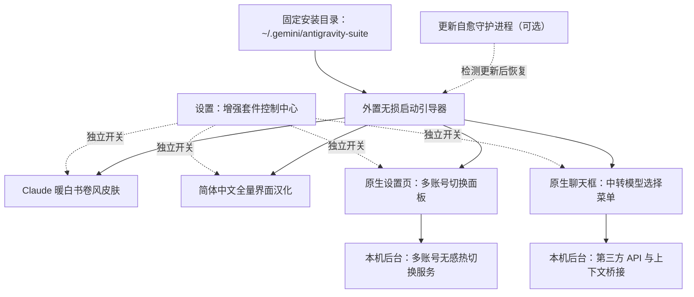

# Antigravity Enhancement Suite (Antigravity 全能增强套件)

<p align="center">
  <strong>Claude 羊皮纸书卷风换肤 · 简体中文全量汉化 · Google 多账号秒级热切换 · 第三方 API / 中转站同会话无缝切换</strong>
</p>

<p align="center">
  
  
  
  <a href="./LICENSE"></a>
</p>

<p align="center">
  
  <br />
  <sub>▲ 左半幅：浅色羊皮纸书卷风 (<code>#FAF9F5</code>) · 右半幅：深色暖炭黑护眼主题 (<code>#1F1E1D</code>)</sub>
</p>

---

## 📖 项目简介

**Antigravity Enhancement Suite** 是专为 **Google Antigravity 2.0 桌面端 (Windows)** 打造的一站式开源增强工具包。它在**不修改、不破坏官方 `app.asar` 核心文件**的前提下，通过外置无损引导与本地后台服务，为 Antigravity 提供四大实用功能：

**四项功能现在可独立启用。** 安装时勾选需要的模块；安装后在「设置 → ✨ 增强套件控制中心」分别开关 Claude 皮肤、中文汉化、多账号切换和 API 中转。可以只汉化并保留官方配色，也可以保持英文界面只用账号或 API 功能。更新自愈计划任务为独立可选项，默认不启用。

1. 🎨 **Claude 书卷风主题皮肤 (`antigravity-claude-skin`)**
   - 复刻 Claude 标志性的 **羊皮纸暖白 (`#FAF9F5`)** 与 **深色暖炭黑 (`#1F1E1D`)** 双模式配色，告别刺眼冷白光。
   - **离线人文衬线排版**：内置离线 `Source Serif 4` 衬线字体与中文思源宋体混排，呈现 **“提问现代干练、AI 回答温润如书”** 的阅读体验。
2. 🇨🇳 **简体中文全量汉化 (`antigravity-claude-skin/i18n`)**
   - 融合 [`Silas-02/antigravity-desktop-cn`](https://github.com/Silas-02/antigravity-desktop-cn) 并补齐 Antigravity v2.22.0+ 最新词库（共 **2,126+ 条** 翻译规则）。
   - 完整覆盖 **主界面、设置页、顶栏菜单、右键菜单与系统托盘菜单**，同时严格保护代码块、终端与用户输入内容不被误翻。
3. 👥 **Google 多账号秒级切换与配额查看 (`antigravity-account-switcher`)**
   - 在原生 **「设置 -> 账号」** 页面与右侧边栏面板内嵌可视化多账号管理卡片。
   - **2 秒无感切换**：无需退出登录或关闭当前窗口，一键即可切换至其他已保存的 Google 账号，并支持实时查看各账号的**模型剩余配额百分比**。
4. 🔌 **第三方 API / 中转站模型无缝切换 (`antigravity-model-switcher`)**
   - 支持接入任意 **OpenAI 兼容接口** 与 **Anthropic (Claude Code) 接口** 的第三方 API 或中转站，支持一键拉取站点可用模型列表。
   - **原生聊天框直接使用**：直接在聊天输入框左下角的模型菜单中选择自定义模型、调节 **思考强度（默认 / 低 / 中 / 高 / 最大）**。
   - **同一对话无缝混用**：支持在同一个对话中途随时从官方模型切换到第三方 API 模型（或随时切回官方模型），上下文自动衔接不断裂，并支持本地文件读写、代码搜索与命令执行等 Agent 工具。

---

## ✨ 核心功能动态演示

### 1. 白天 / 黑夜双主题皮肤切换与全量汉化（设置页单行切换：白天 / 黑夜 / 跟随系统）
<p align="center">
  
</p>

### 2. 聊天框一键切中转模型 + 悬停调节思考强度
<p align="center">
  
</p>

### 3. 设置页 2 秒无感切换 Google 账号 + 实时配额查看
<p align="center">
  
</p>

---

## 🏗️ 工作原理与架构图



> 💡 **关于本机后台服务的说明**：套件会在您自己的电脑后台自动运行一个轻量级本地服务（监听本机回环地址 `127.0.0.1:19823`），专门负责处理界面与本地配置文件之间的账号切换和 API 转发。所有用户安装后均使用该标准本机回环地址，不会向任何外部服务器暴露端口。

---

## 🔒 隐私与数据安全说明

- **账号与密钥保存在本机**：默认安装到 `~/.gemini/antigravity-suite/`，账号与模型数据位于对应模块的 `data/` 中。模型按服务商共享 API Key，界面列表只显示掩码。配置 JSON 本身未加密，应按凭据文件保护；请求模型或登录时会按功能向您选择的 API 服务商或 Google 发送所需数据。
- **零外部数据收集**：本开源项目不包含任何统计或遥测代码。
- **仓库防呆保护**：`.gitignore` 已默认排除所有个人配置文件（`data/*.json`）、聊天桥接缓存与备份目录；仓库中仅提供空白的脱敏模板 [`accounts.example.json`](./antigravity-account-switcher/data/accounts.example.json) 与 [`models.example.json`](./antigravity-model-switcher/data/models.example.json)。

---

## 🚀 快速开始（一键安装）

### 1. 环境要求
- **操作系统**：Windows 10 / 11 (64 位)
- **基础环境**：已安装 [Node.js](https://nodejs.org/) **22 或以上版本**
- **目标软件**：已安装 Google Antigravity 桌面客户端

### 2. 下载并一键安装

下载 [仓库 ZIP](https://github.com/Chenxuan-Xie/antigravity-enhancement-suite/archive/refs/heads/main.zip) 并解压，双击 **`双击一键安装.cmd`**，勾选需要的功能后安装。安装器将运行时复制到固定应用数据目录；**成功安装后，下载或克隆的源文件夹可以移动或删除**。

也可以用 PowerShell 安装：

```powershell
git clone https://github.com/Chenxuan-Xie/antigravity-enhancement-suite.git
cd antigravity-enhancement-suite

# 打开可视化功能选择窗口
powershell -ExecutionPolicy Bypass -File .\install-all.ps1

# 只汉化，保留官方颜色；不注册自愈任务
powershell -ExecutionPolicy Bypass -File .\install-all.ps1 -Modules i18n -NoUi

# 只启用账号与 API，并选择更新自愈
powershell -ExecutionPolicy Bypass -File .\install-all.ps1 -Modules accounts,api -EnableGuardian -NoUi
```

**一行命令下载并启动安装器（PowerShell）：**

```powershell
& { $installer = Join-Path $env:TEMP 'agy-suite-install.ps1'; Invoke-WebRequest 'https://raw.githubusercontent.com/Chenxuan-Xie/antigravity-enhancement-suite/main/install-online.ps1' -OutFile $installer; powershell -NoProfile -ExecutionPolicy Bypass -File $installer }
```

`-RuntimeDir` 可指定固定安装目录，例如 `D:\AppsData\antigravity-suite`；`-ConfigDir` 可指定 Antigravity 插件配置目录。以后更新或卸载自定义安装时也传入相同的 `-RuntimeDir`。

> 📌 **如果您的 Antigravity 安装在自定义位置**，可以通过 `-AntigravityDir` 参数指定 `Antigravity.exe` 所在的文件夹路径：
> ```powershell
> powershell -ExecutionPolicy Bypass -File .\install-all.ps1 -AntigravityDir "D:\YourCustomPath\Antigravity"
> ```

**安装脚本会自动为您完成以下步骤**：
1. 自动识别本机 Antigravity 安装目录；
2. 复制核心到固定运行时目录，插件、启动器、MCP 和可选守护均指向该目录；重装保留账号、模型与聊天数据；
3. 根据勾选项启用插件和界面模块，写入外置启动器，官方 ASAR 保持不变；
4. 应用空闲且 CDP 可用时加载界面，无需刷新聊天；原生菜单与窗口启动钩子的升级在下一次应用启动时完整生效；生成期间安装和重新注入会等待用户完成任务；
5. 仅在选择更新自愈时注册计划任务与开机自启；未启用时，本机后端由应用启动，应用关闭后退出。关闭自愈后，官方更新若移除启动器，需要重新运行安装器。

---

## 📚 功能使用指南

### 一、Claude 书卷双色皮肤与简体中文汉化 (`antigravity-claude-skin`)

1. **设置页一键切换皮肤（白天 / 黑夜 / 跟随系统）**：
   - 打开左下角 **「设置 (Settings) → 通用」**，在列表第一行 **「切换皮肤」**（`白天` / `黑夜` / `跟随系统`）中即可实时切换三档模式：
     - **☀️ 白天（羊皮纸浅色 `#FAF9F5`）**：复刻 Claude Desktop 标志性羊皮纸暖白画布与焦糖赤陶点缀；
     - **🌙 黑夜（暖炭黑深色 `#1F1E1D`）**：复刻 Claude Desktop 经典暖炭黑深色护眼画布（侧栏 `#161514`、卡片 `#282725`、米白正文 `#ECE9E2`），彻底告别刺眼纯黑与反差眩光；
     - **💻 跟随系统**：自动监听 Windows 10/11 系统深浅色设置并实时无感切换（连同 Windows 原生右上角窗口控制栏自动同步变色）。
2. **设置专属首页问候语称呼**：
   - 新建会话首页默认根据时间显示 `早上好`、`下午好`、`晚上好`。
   - 在「设置 → 增强套件控制中心」的「首页问候语称呼」输入名字，实时保存；清空恢复默认称呼。汉化关闭时使用英文问候语。
3. **自定义字体字号或翻译词条**：
   - 控制中心可选择「跟随主题 / 书卷衬线体 / 现代无衬线体」及「小 / 标准 / 大」字号，无需改 CSS。关闭皮肤且选择跟随主题时保留官方字体与配色。
   - 开发者修改源码样式或词典后，以下命令将更新固定目录中的运行时，保留当前功能开关与数据：
     ```powershell
     powershell -ExecutionPolicy Bypass -File .\live-reload.ps1
     ```

---

### 二、Google 多账号秒级切换 (`antigravity-account-switcher`)

安装后，系统会自动识别并记录您当前已登录的 Google 账号。您可以通过以下两个位置管理账号：
- **快捷入口**：聊天输入框旁的账号配额胶囊，点击即可打开切换菜单；显示当前模型匹配的配额，无法匹配时显示最低已知配额，缓存数据会标注「缓存」。每分钟检查账号状态，当前账号配额按需每 5 分钟刷新，也可手动刷新。
- **低配额提醒**：新鲜配额低于 10% 或检测到原生额度限制提示时，提供备用账号切换按钮；不会自动切号，生成过程中不能切换。提醒可在控制中心关闭。
- **方式一（推荐）**：打开 Antigravity **「设置 (`Ctrl+,`) -> 账号」**，页面顶部会直接显示 **「多账号无缝热切换」** 面板。
- **方式二**：点击窗口右侧边栏打开 **Account Switcher** 插件面板。

#### 常用操作：
1. **添加新账号（无需退出当前账号）**：
   - **浏览器登录授权**：点击 **「+ 添加新账号 (浏览器登录)」**，在弹出的浏览器页面中登录另一个 Google 账号并确认授权，即可自动添加至列表。
   - **粘贴回调链接 / 授权码**：若浏览器未自动跳回，可将授权后浏览器地址栏的完整链接粘贴到手动输入框中完成添加。
   - **导入 Refresh Token**：支持直接粘贴已有的 Google `refresh_token`（以 `1//` 开头）快速导入账号。
2. **一键无感切换**：
   - 点击目标账号右侧的 **「切换」** 按钮，后台会自动更新系统凭据并仅重启后台语言服务进程，**约 2 秒内即可完成账号切换**，当前打开的代码窗口与对话均不会关闭。
3. **查看模型剩余配额**：
   - 点击 **「刷新配额」** 即可查看每个账号下各模型的剩余额度百分比与重置时间，方便在额度用尽时及时切换备用账号。

---

### 三、第三方 API / 中转站模型无缝切换 (`antigravity-model-switcher`)

支持将任意兼容 **OpenAI (`/v1/chat/completions`)** 或 **Anthropic / Claude (`/v1/messages`)** 协议的第三方 API 或中转站接入 Antigravity 原生聊天框。

#### 1. 添加您的 API Key 与模型
先在添加弹窗选择服务商预设：**OneAPI / NewAPI、自定义、DeepSeek、OpenRouter、硅基流动、OpenAI、Anthropic**。官方预设填写地址与协议，自定义站点的地址由用户提供。填写一次 Key，拉取模型列表后勾选多个模型并批量导入；不提供模型列表的站点仍可手动填写 Model ID。

之后选择「已保存服务商」即可复用地址和密钥；修改所选服务商的 Key 或地址会同步更新关联模型。旧版配置按地址、协议和密钥分组迁移，使用不同密钥的记录保持独立，迁移前保留原模型文件备份。

预设地址参考 [DeepSeek 文档](https://api-docs.deepseek.com/)、[OpenRouter 文档](https://openrouter.ai/docs/api/api-reference/models/get-models)、[硅基流动文档](https://api-docs.siliconflow.cn/docs/userguide/quickstart)、[OpenAI 文档](https://developers.openai.com/api/reference/resources/chat/subresources/completions/methods/create) 和 [Anthropic 文档](https://platform.claude.com/docs/en/api/messages/create)。实际模型列表与参数透传能力取决于所选服务商。
您可以通过以下任意一种方式添加模型：
- **在聊天框直接添加**：点击底部聊天输入框左下角的 **模型选择菜单**，在菜单底部的 **「⚡ 第三方 API / 中转站模型」** 区域点击 **「+ 添加 / 管理中转模型」**。
- **在右侧面板添加**：打开右侧边栏的 **API Model Switcher** 面板进行配置。
- 密钥建议在专用表单中填写，避免进入聊天历史。

**填写说明**：
| 配置项 | 是否必填 | 填写说明 |
| :--- | :---: | :--- |
| **显示名称** | 选填 | 在菜单中展示的名称，例如 `Claude 4.5 Sonnet (中转)` |
| **接口地址 (`Base URL`)** | **必填** | 中转站地址，例如 `https://api.xxx.com/v1` |
| **API Key** | **必填** | 您的 API 密钥（`sk-...`）。填好地址和密钥后，可点击 **「从站点拉取模型列表」** 自动选择模型 |
| **模型 ID (`Model ID`)** | **必填** | 接口实际调用的模型名，如 `claude-sonnet-4-5-20250929`、`gpt-5`、`deepseek-reasoner` |
| **协议类型** | 选填 | 默认选 `自动识别 (auto)` 即可，也可手动指定 `Anthropic` 或 `OpenAI` |

#### 2. 切换模型与调节思考强度
- **一键切换**：在聊天输入框左下角的模型菜单中，点击您添加的中转模型即可切换过去；随时点击官方模型即可切回官方通道。
- **调节思考强度**：对于支持深度思考的模型（如 Claude 3.7/4.x、OpenAI o1/o3/GPT-5、DeepSeek R1 等），将鼠标悬停在菜单里的模型名称上，会展开 **思考强度子菜单（默认 / 低 / 中 / 高 / 最大）**，可按需自由选择。
- **同会话上下文自动衔接**：在同一个对话中，无论您是先用官方模型聊了几轮再切到中转模型，还是先用中转模型聊完再切回官方模型，插件都会自动帮您同步前文对话内容，不会出现报错或失忆。

#### 3. 查看 Token 消耗

在控制中心开启「显示 Token 消耗」，聊天输入区与 API 管理面板可查看本轮输入/输出和会话累计 Token。统计包含一次任务中的各次工具与模型请求，Anthropic 缓存输入也计入输入数。只显示接口实际返回的数据；缺失时显示「—」或「部分请求未返回统计」，不估算费用。历史记录中的统计随会话保存，面板可点击刷新查看最新数据。

中转请求的运行提示区分收到思考内容、正在输出、执行工具和等待响应；网络保活不代表模型在思考。默认按连续 120 秒无上游响应超时，持续输出和工具执行不受固定轮数上限影响。

---

## 🛠️ 一键卸载与恢复官方原版

双击 **`双击一键卸载.cmd`**；也可以运行以下命令。源文件夹已删除时，直接运行固定安装目录中的 `uninstall-all.ps1`：

```powershell
powershell -ExecutionPolicy Bypass -File .\uninstall-all.ps1
```

卸载脚本会：
1. 移除开机自启项与后台更新自愈计划任务；
2. 停止后台本地服务并清理外置启动器；
3. 仅还原套件的插件配置项，保留安装后修改的无关设置；
4. 应用空闲且可连接时关闭界面模块，重启后完整恢复官方启动行为。固定目录中的账号、密钥与会话数据保留，不会随卸载删除。

---

## 📁 目录结构

```text
antigravity-enhancement-suite/
├── install-all.ps1                     # 一键全量安装脚本（推荐入口）
├── uninstall-all.ps1                   # 一键完整卸载与还原官方界面脚本
├── live-reload.ps1                     # 样式、词条与前端脚本实时热更新工具
├── 双击一键安装.cmd / 双击一键卸载.cmd # 可视化安装入口
├── install-online.ps1                  # 一行下载安装入口
├── suite/                              # 独立开关、控制中心、固定运行时安装与回归
├── antigravity-claude-skin/            # [模块一] Claude 暖白书卷风皮肤 + 简体中文全量汉化 + 更新自愈守护
├── antigravity-account-switcher/       # [模块二] Google 多账号一键无感热切换与配额查看插件
└── antigravity-model-switcher/         # [模块三] 第三方 API / 中转站无缝切换与同会话上下文衔接插件
```

---

## 🙏 致谢与开源协议

- 简体中文基础词库参考并融合了 [Silas-02/antigravity-desktop-cn](https://github.com/Silas-02/antigravity-desktop-cn) 项目的翻译贡献。
- 本项目采用 [MIT License](./LICENSE) 开源协议，欢迎 Star、Fork 与提交 PR！
