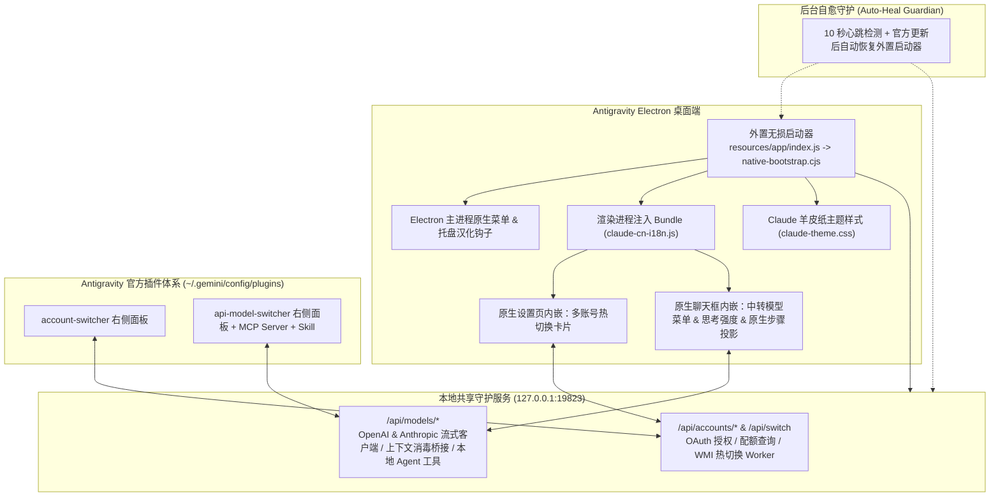

# Antigravity Enhancement Suite (Antigravity 全能增强套件)

<p align="center">
  <strong>Claude 羊皮纸书卷风换肤 · 简体中文全量汉化 · Google 多账号秒级热切换 · 第三方 API / 中转站同会话无缝桥接</strong>
</p>

---

## 📖 项目简介

**Antigravity Enhancement Suite** 是专为 **Google Antigravity 2.0 桌面端 (Windows)** 打造的一站式开源增强套件。它在**不修改、不破坏官方 `app.asar` 归档文件任何字节**的前提下，通过外置无损启动器（External Bootstrap）与本地守护服务，为 Antigravity 带来四大核心能力：

1. 🎨 **Claude Desktop 羊皮纸暖白皮肤 (`antigravity-claude-skin`)**
   - 复刻 Claude 标志性的 **Warm Parchment (`#FAF9F5`) 羊皮纸暖白** 与 **Warm Charcoal (`#1F1E1D`) 深色暖炭黑** 双模式视觉体系。
   - **离线人文衬线排版**：内置离线 `Source Serif 4` 可变衬线字体（`.woff2`）与中文思源宋体混排，呈现 **“提问现代干练、AI 回答温润如书”** 的阅读体验。
2. 🇨🇳 **简体中文全量汉化引擎 (`antigravity-claude-skin/i18n`)**
   - 深度融合 [`Silas-02/antigravity-desktop-cn`](https://github.com/Silas-02/antigravity-desktop-cn) 并补齐 Antigravity v2.22.0+ 最新词库（共计 **2,126+ 条** 静态词条与动态正则规则）。
   - 同时覆盖 **前端界面 / Shadow DOM** 与 **Electron 原生顶栏菜单、右键菜单、系统托盘菜单**，严格跳过代码块、终端与用户输入区，零污染代码。
3. 👥 **Google 多账号无感热切换与配额监控 (`antigravity-account-switcher`)**
   - 在原生 `设置 -> 账号 (Settings -> Account)` 页面与右侧插件面板提供可视化多账号管理卡片。
   - **2 秒无感热切换**：无需退出登录或重启整个 IDE，自动同步 Windows 凭据管理器 (`gemini:antigravity`) 并仅热重启后台 `language_server.exe`，保留当前打开的窗口与工作区。
   - 支持 **OAuth 浏览器一键授权添加新账号**、**导入 `refresh_token`**，以及实时查看各账号的 **模型配额剩余百分比 (Quota Summary)**。
4. 🔌 **第三方 API / Token 中转站无缝切换器 (`antigravity-model-switcher`)**
   - 支持接入任意 **OpenAI 兼容 (`/v1/chat/completions`)** 与 **Anthropic / Claude Code (`/v1/messages`)** 协议的第三方 API 或中转站，支持一键拉取站点模型列表。
   - **原生界面深度融合**：直接在聊天输入框的模型下拉菜单中切换自定义模型、调节 **思考强度 (Reasoning Effort: 低/中/高/最大)**；中转模型的流式回复、思考折叠区、工具调用卡片直接投影到 Antigravity 原生聊天步骤中渲染。
   - **WorkBuddy 风格同会话双向桥接 (`Context Bridge`)**：支持在**同一个对话中途**随时从官方模型切换到第三方 API 模型，或从第三方模型切回官方模型，自动完成上下文消毒（剥离加密签名与内部标签）与历史同步。
   - **本地 Agent 工具引擎 + MCP 协同**：内置 `read_file`、`write_file`、`replace_in_file`、`list_dir`、`search_files`、`run_command` 六大本地工具与标准 MCP Server (`api-model-switcher-mcp`)。

---

## 🏗️ 整体架构



---

## 🔒 隐私与数据安全说明

- **100% 本地存储**：您添加的所有 Google 账号凭证（保存在 `antigravity-account-switcher/data/accounts.json` 与 Windows 系统凭据管理器中）以及第三方 API Key（保存在 `antigravity-model-switcher/data/models.json` 中）**仅存储在您的本地计算机上**。
- **零外部遥测**：本套件不包含任何统计、遥测或第三方上报代码；除您主动发起的 Google OAuth / 配额查询请求及您自行配置的 API 中转站请求外，所有内部通信均严格限制在本地回环地址 `127.0.0.1`。
- **Git 防护**：仓库 `.gitignore` 已默认屏蔽所有 `data/*.json`、`data/bridges/`、`backup/` 与日志文件，仓库内仅提供脱敏后的 `accounts.example.json` 与 `models.example.json` 结构示例。

---

## 🚀 快速开始（一键安装）

### 1. 环境准备
- **操作系统**：Windows 10 / 11 (x64)
- **运行环境**：已安装 [Node.js](https://nodejs.org/)（建议 v18 或更高版本，确保 `node` 在系统 `PATH` 中）
- **目标软件**：已安装 Google Antigravity 桌面客户端

### 2. 克隆仓库并执行一键安装

在 PowerShell 中执行以下命令（建议将仓库克隆在固定目录，因为外置启动器与守护进程会直接引用仓库目录中的脚本）：

```powershell
git clone https://github.com/Chenxuan-Xie/antigravity-enhancement-suite.git
cd antigravity-enhancement-suite

# 执行一键全量安装（自动探测 Antigravity 安装位置与 Node.js 路径）
powershell -ExecutionPolicy Bypass -File .\install-all.ps1
```

> 💡 **如果您的 Antigravity 安装在非标准自定义路径**，可以通过 `-AntigravityDir` 参数显式指定包含 `Antigravity.exe` 的目录：
> ```powershell
> powershell -ExecutionPolicy Bypass -File .\install-all.ps1 -AntigravityDir "D:\YourCustomPath\Antigravity"
> ```

**安装脚本会自动完成以下工作**：
1. 自动探测本机 Antigravity 的 `resources` 目录并缓存路径配置；
2. 将 `account-switcher` 与 `api-model-switcher` 插件安装并启用至 `~/.gemini/config/plugins/`；
3. 编译内嵌离线字体的 `claude-theme.css` 与融合汉化、账号切换、模型切换的 `claude-cn-i18n.js`；
4. 在 `resources/app/` 下生成外置无损引导器（不改动官方 `app.asar`）；
5. 若 Antigravity 当前正在运行，立即通过 CDP 将皮肤、汉化与插件注入当前窗口（无需重启即可看到效果）；
6. 注册 Windows 登录自启与计划任务 `Antigravity Claude Skin Guardian`，当 Antigravity 官方版本自动更新后，守护进程会在数秒内无损自动恢复增强环境。

---

## 📚 三大模块详细使用指南

### 一、Claude 暖白书卷风皮肤 & 简体中文汉化 (`antigravity-claude-skin`)

1. **深浅色主题切换**：
   - 支持浅色模式（**Warm Parchment 羊皮纸暖白 `#FAF9F5`**）与深色模式（**Warm Charcoal 暖炭黑 `#1F1E1D`**），可在 Antigravity 设置中自由切换。
2. **自定义首页问候语称呼**：
   - 新建会话首页默认根据当前时间显示 `早上好` / `上午好` / `下午好` / `晚上好`。
   - 如需显示您的专属称呼（例如 `早上好，Alex`），只需在 Antigravity 开发者工具控制台（`Ctrl+Shift+I`）执行一次：
     ```javascript
     localStorage.setItem('__agy_greeting_name__', 'Alex');
     ```
     清除称呼可执行 `localStorage.removeItem('__agy_greeting_name__')`。
3. **自定义样式与中文词条热重载**：
   - 修改样式源码 [`antigravity-claude-skin/src/claude-core.css`](./antigravity-claude-skin/src/claude-core.css) 或增量词库 [`antigravity-claude-skin/i18n/dicts/v2.22.0_overlay.json`](./antigravity-claude-skin/i18n/dicts/v2.22.0_overlay.json) 后，运行根目录下的：
     ```powershell
     powershell -ExecutionPolicy Bypass -File .\live-reload.ps1
     ```
     无需重启 Antigravity，当前窗口即刻实时刷新生效。

---

### 二、Google 多账号无感热切换 (`antigravity-account-switcher`)

安装完成后，会自动捕捉并同步您当前已登录的 Google 账号作为第一个保存的账号。您可以通过以下**两个入口**管理与切换账号：
- **入口 A（推荐）**：打开 Antigravity 原生 **设置 (`Ctrl+,`) -> 账号 (Account)**，页面顶部将直接展示 **“多账号无缝热切换 (Multi-Account Hot Switcher)”** 卡片。
- **入口 B**：在右侧边栏打开 **Account Switcher** 插件面板。

#### 功能操作：
1. **添加新账号（无需退出当前账号）**：
   - **方式 1（OAuth 浏览器授权）**：点击 **「+ 添加新账号 (浏览器登录)」**，在弹出的浏览器中选择另一个 Google 账号完成授权，授权成功后会自动保存至账号列表。
   - **方式 2（手动粘贴授权码/回调链接）**：若浏览器未自动跳转回本地端口，可将浏览器地址栏的回调 URL 或 `code` 粘贴至手动完成框中。
   - **方式 3（导入 `refresh_token`）**：支持直接粘贴已有的 Google OAuth `refresh_token`（`1//...`）导入账号。
2. **一键秒级热切换**：
   - 点击任意非当前账号卡片右侧的 **「切换」** 按钮，后台 Worker 会自动刷新该账号的 Token、更新 Windows Credential Manager (`gemini:antigravity`) 与 `app_storage.json`，并仅重启 `language_server.exe` 进程，约 **2 秒内**即可无感完成切换。
3. **配额查询与备注管理**：
   - 点击 **「刷新配额」** 可实时查看各账号下不同模型分组的剩余额度百分比与重置时间；支持为每个账号设置自定义标签（如“主力号”、“备用号”）。

> 📄 数据结构参考：[`antigravity-account-switcher/data/accounts.example.json`](./antigravity-account-switcher/data/accounts.example.json)

---

### 三、第三方 API / Token 中转站无缝切换 (`antigravity-model-switcher`)

允许您在 Antigravity 中接入任何支持 **OpenAI (`/v1/chat/completions`)** 或 **Anthropic / Claude Code (`/v1/messages`)** 协议的第三方 API 服务或 Token 中转站，并与官方模型在同一对话中无缝混用。

#### 1. 添加与配置中转模型
您可以通过以下任意一种方式添加自定义模型：
- **方式 A（原生聊天框菜单）**：点击聊天输入框左下角的**模型选择器**，在菜单底部的 **「⚡ 第三方 API / 中转站模型」** 分组中点击 **「+ 添加 / 管理中转模型」**。
- **方式 B（右侧边栏面板）**：打开右侧边栏的 **API Model Switcher** 面板。
- **方式 C（直接对话让 AI 配置）**：在聊天框中直接对 Agent 说：`帮我添加一个中转模型，地址是 https://api.xxx.com/v1，API Key 是 sk-xxx，模型 ID 是 claude-sonnet-4-5-20250929`（通过内置 MCP 工具自动完成保存与连接测试）。

**配置项说明**：
| 字段 | 必填 | 说明 |
| :--- | :---: | :--- |
| **显示名称 (`name`)** | 否 | 显示在模型菜单中的易读名称，如 `Claude 4.5 Sonnet (中转)` |
| **接口地址 (`baseUrl`)** | 是 | 中转站 Base URL（如 `https://api.xxx.com/v1`）或完整端点地址 |
| **API Key (`apiKey`)** | 是 | 您的中转站密钥（`sk-...`），支持点击 **「从站点拉取模型列表」** 自动填充模型 ID |
| **模型 ID (`modelId`)** | 是 | 实际请求的模型名称，如 `claude-sonnet-4-5-20250929`、`gpt-5`、`deepseek-reasoner` |
| **协议类型 (`protocol`)** | 否 | `auto`（根据模型名自动识别）、`anthropic`（Claude `/v1/messages`）或 `openai`（`/v1/chat/completions`） |

#### 2. 在聊天中无缝切换与调节思考强度
- **切换模型**：点击聊天输入框左下角的模型菜单，直接点击您添加的自定义模型即可激活；点击任意官方模型则立即切回官方通道。
- **调节思考强度 (Reasoning Effort)**：对于支持推理强度的模型（如 Claude 3.7/4.x、OpenAI o1/o3/GPT-5、DeepSeek Reasoner 等），鼠标悬停在模型菜单对应行上会展开 **思考强度子菜单（默认 / 低 / 中 / 高 / 最大）**，每个模型独立记忆档位。
- **原生聊天体验**：
  - 使用中转模型发送消息时，无需事先调用官方模型，首条消息即可通过原生 `StartCascade` 创建正式会话并进入左侧历史列表；
  - 实时展示流式思考过程折叠区、Markdown 正文、本地工具调用卡片（文件读写、代码替换、目录搜索、命令执行）以及上游响应计时状态；
  - 支持直接点击原生停止按钮中断生成。

#### 3. 同会话双向无缝上下文桥接 (`Context Bridge`)
- **从官方切到中转**：自动提取当前对话的官方历史，剥离会导致第三方接口报错的加密 `thinking.signature` 签名块与内部元数据标签，与本地中转记录按时间轴合并后发送给中转模型。
- **从中转切回官方**：当您切回官方模型发送新消息时，系统会自动将刚才在中转模型中产生的未同步问答包裹在 `<!-- ANTIGRAVITY_BRIDGE_SYNC_START -->` 桥接块中附带给官方模型，并在官方 transcript 确认落盘后标记已同步，真正做到**同一个对话窗口内任意穿插切换、上下文永不断裂**。

> 📄 数据结构参考：[`antigravity-model-switcher/data/models.example.json`](./antigravity-model-switcher/data/models.example.json)

---

## 🛠️ 卸载与还原官方原版

如果您希望随时暂停使用或彻底卸载本增强套件，只需在 PowerShell 中运行：

```powershell
powershell -ExecutionPolicy Bypass -File .\uninstall-all.ps1
```

该脚本会：
1. 停止并注销 `Antigravity Claude Skin Guardian` 计划任务与开机自启项；
2. 停止后台守护进程并移除 `resources/app` 外置启动目录；
3. 恢复原版 `config.json` 备份；
4. 若 Antigravity 正在运行，通过 CDP **当场将窗口实时还原为官方默认皮肤与英文原版界面**（无需重启应用）；
5. 您本地保存在 `data/` 目录下的账号与 API 配置会被安全保留，不会误删。

---

## 📁 仓库目录结构

```text
antigravity-enhancement-suite/
├── install-all.ps1                     # 一键全量安装脚本（推荐入口）
├── uninstall-all.ps1                   # 一键完整卸载与还原官方界面脚本
├── live-reload.ps1                     # 修改样式/词条/前端注入脚本后的实时热重载工具
├── antigravity-claude-skin/            # [模块一] Claude 暖白书卷风皮肤 + 简体中文全量汉化 + 外置启动与自愈守护
│   ├── src/claude-core.css             # 皮肤核心 CSS 源码
│   ├── fonts/                          # 离线内嵌 Source Serif 4 可变衬线字体 (.woff2)
│   ├── i18n/dicts/                     # 2,126+ 条简体中文词典库（含 v2.22.0_overlay.json）
│   └── tools/                          # 构建器、外置引导器 (native-bootstrap.cjs)、CDP 自动发现与自愈守护
├── antigravity-account-switcher/       # [模块二] Google 多账号一键无感热切换与配额监控插件
│   ├── core/                           # OAuth 授权流、Windows 凭据管理、热切换 Worker、共享守护进程 (19823)
│   ├── data/accounts.example.json      # 脱敏账号存储结构示例
│   └── plugin/                         # Antigravity 侧边栏插件包
└── antigravity-model-switcher/         # [模块三] 第三方 API / Token 中转站无缝切换与同会话桥接插件
    ├── core/                           # 双协议流式客户端、上下文消毒桥接、本地 Agent 工具、MCP Server
    ├── data/models.example.json        # 脱敏中转模型配置结构示例
    ├── plugin/                         # Antigravity 插件包（含 Sidecar 面板、Skill 与 AGENTS.md 规则）
    └── tools/                          # 运行时热重载与隔离回归验证套件
```

---

## 🙏 致谢与开源协议

- 简体中文基础词库参考并融合了 [Silas-02/antigravity-desktop-cn](https://github.com/Silas-02/antigravity-desktop-cn) 项目的优秀工作。
- 本项目基于 [MIT License](./LICENSE) 开源发布。欢迎提交 Issue 与 Pull Request！
