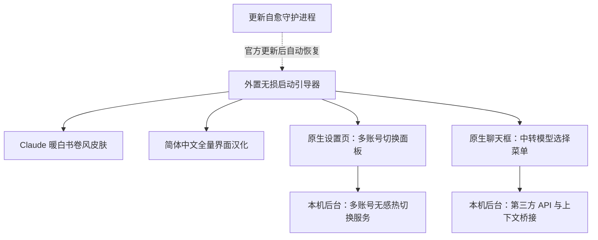

# Antigravity Enhancement Suite (Antigravity 全能增强套件)

<p align="center">
  <strong>Claude 羊皮纸书卷风换肤 · 简体中文全量汉化 · Google 多账号秒级热切换 · 第三方 API / 中转站同会话无缝切换</strong>
</p>

<p align="center">
  
  
  
  <a href="./LICENSE"></a>
</p>

<p align="center">
  
  <br />
  <sub>▲ 左半幅：浅色羊皮纸书卷风 (<code>#FAF9F5</code>) · 右半幅：深色暖炭黑护眼主题 (<code>#1F1E1D</code>)</sub>
</p>

---

## 📖 项目简介

**Antigravity Enhancement Suite** 是专为 **Google Antigravity 2.0 桌面端 (Windows)** 打造的一站式开源增强工具包。它在**不修改、不破坏官方 `app.asar` 核心文件**的前提下，通过外置无损引导与本地后台服务，为 Antigravity 提供四大实用功能：

1. 🎨 **Claude 书卷风主题皮肤 (`antigravity-claude-skin`)**
   - 复刻 Claude 标志性的 **羊皮纸暖白 (`#FAF9F5`)** 与 **深色暖炭黑 (`#1F1E1D`)** 双模式配色，告别刺眼冷白光。
   - **离线人文衬线排版**：内置离线 `Source Serif 4` 衬线字体与中文思源宋体混排，呈现 **“提问现代干练、AI 回答温润如书”** 的阅读体验。
2. 🇨🇳 **简体中文全量汉化 (`antigravity-claude-skin/i18n`)**
   - 融合 [`Silas-02/antigravity-desktop-cn`](https://github.com/Silas-02/antigravity-desktop-cn) 并补齐 Antigravity v2.22.0+ 最新词库（共 **2,126+ 条** 翻译规则）。
   - 完整覆盖 **主界面、设置页、顶栏菜单、右键菜单与系统托盘菜单**，同时严格保护代码块、终端与用户输入内容不被误翻。
3. 👥 **Google 多账号秒级切换与配额查看 (`antigravity-account-switcher`)**
   - 在原生 **「设置 -> 账号」** 页面与右侧边栏面板内嵌可视化多账号管理卡片。
   - **2 秒无感切换**：无需退出登录或关闭当前窗口，一键即可切换至其他已保存的 Google 账号，并支持实时查看各账号的**模型剩余配额百分比**。
4. 🔌 **第三方 API / 中转站模型无缝切换 (`antigravity-model-switcher`)**
   - 支持接入任意 **OpenAI 兼容接口** 与 **Anthropic (Claude Code) 接口** 的第三方 API 或中转站，支持一键拉取站点可用模型列表。
   - **原生聊天框直接使用**：直接在聊天输入框左下角的模型菜单中选择自定义模型、调节 **思考强度（默认 / 低 / 中 / 高 / 最大）**。
   - **同一对话无缝混用**：支持在同一个对话中途随时从官方模型切换到第三方 API 模型（或随时切回官方模型），上下文自动衔接不断裂，并支持本地文件读写、代码搜索与命令执行等 Agent 工具。

---

## ✨ 核心功能动态演示

### 1. 换肤与汉化前后对比（人文衬线体排版 + 原生右键菜单汉化）
<p align="center">
  
</p>

### 2. 聊天框一键切中转模型 + 悬停调节思考强度
<p align="center">
  
</p>

### 3. 设置页 2 秒无感切换 Google 账号 + 实时配额查看
<p align="center">
  
</p>

---

## 🏗️ 工作原理与架构图



> 💡 **关于本机后台服务的说明**：套件会在您自己的电脑后台自动运行一个轻量级本地服务（监听本机回环地址 `127.0.0.1:19823`），专门负责处理界面与本地配置文件之间的账号切换和 API 转发。所有用户安装后均使用该标准本机回环地址，不会向任何外部服务器暴露端口。

---

## 🔒 隐私与数据安全说明

- **账号与密钥 100% 保存在您本机**：您登录的 Google 账号凭证（运行后自动保存在本地 `antigravity-account-switcher/data/accounts.json` 及 Windows 系统凭据管理器中）和您填写的第三方 API Key（运行后保存在本地 `antigravity-model-switcher/data/models.json` 中）**仅存放在您自己的电脑上**。
- **零外部数据收集**：本开源项目不包含任何统计或遥测代码。
- **仓库防呆保护**：`.gitignore` 已默认排除所有个人配置文件（`data/*.json`）、聊天桥接缓存与备份目录；仓库中仅提供空白的脱敏模板 [`accounts.example.json`](./antigravity-account-switcher/data/accounts.example.json) 与 [`models.example.json`](./antigravity-model-switcher/data/models.example.json)。

---

## 🚀 快速开始（一键安装）

### 1. 环境要求
- **操作系统**：Windows 10 / 11 (64 位)
- **基础环境**：已安装 [Node.js](https://nodejs.org/)（建议 v18 及以上版本）
- **目标软件**：已安装 Google Antigravity 桌面客户端

### 2. 下载并一键安装

打开 PowerShell，将本仓库克隆到您电脑上的固定目录（守护服务会直接引用该目录中的脚本，安装后请勿随意移动文件夹），然后运行安装脚本：

```powershell
git clone https://github.com/Chenxuan-Xie/antigravity-enhancement-suite.git
cd antigravity-enhancement-suite

# 一键安装全部功能（自动识别本机 Antigravity 与 Node.js 路径）
powershell -ExecutionPolicy Bypass -File .\install-all.ps1
```

> 📌 **如果您的 Antigravity 安装在自定义位置**，可以通过 `-AntigravityDir` 参数指定 `Antigravity.exe` 所在的文件夹路径：
> ```powershell
> powershell -ExecutionPolicy Bypass -File .\install-all.ps1 -AntigravityDir "D:\YourCustomPath\Antigravity"
> ```

**安装脚本会自动为您完成以下步骤**：
1. 自动识别本机 Antigravity 安装目录；
2. 将多账号切换与 API 模型切换插件安装到 `~/.gemini/config/plugins/` 并自动启用；
3. 编译 Claude 主题皮肤与简体中文汉化包，并配置外置无损启动器；
4. 如果 Antigravity 当前正在运行，**无需重启软件，窗口会当场实时切换为中文与 Claude 主题**；
5. 注册后台自愈守护任务：当 Antigravity 后续触发官方版本更新时，守护进程会自动为您恢复皮肤、汉化与插件功能。

---

## 📚 功能使用指南

### 一、Claude 暖白皮肤与简体中文汉化 (`antigravity-claude-skin`)

1. **浅色 / 深色模式切换**：
   - 同时支持浅色模式（**羊皮纸暖白 `#FAF9F5`**）与深色模式（**暖炭黑 `#1F1E1D`**），可在 Antigravity 设置中随心切换。
2. **设置专属首页问候语称呼**：
   - 新建会话首页默认根据时间显示 `早上好`、`下午好`、`晚上好`。
   - 如果希望显示您的名字（例如 `早上好，Alex`），可按 `Ctrl+Shift+I` 打开开发者工具控制台，输入并回车：
     ```javascript
     localStorage.setItem('__agy_greeting_name__', 'Alex');
     ```
     （如需恢复默认无称呼状态，执行 `localStorage.removeItem('__agy_greeting_name__')` 即可）。
3. **自定义字体字号或翻译词条**：
   - 修改样式文件 [`antigravity-claude-skin/src/claude-core.css`](./antigravity-claude-skin/src/claude-core.css) 或自定义词典 [`antigravity-claude-skin/i18n/dicts/v2.22.0_overlay.json`](./antigravity-claude-skin/i18n/dicts/v2.22.0_overlay.json) 后，运行根目录下的热更新命令即可立即生效：
     ```powershell
     powershell -ExecutionPolicy Bypass -File .\live-reload.ps1
     ```

---

### 二、Google 多账号秒级切换 (`antigravity-account-switcher`)

安装后，系统会自动识别并记录您当前已登录的 Google 账号。您可以通过以下两个位置管理账号：
- **方式一（推荐）**：打开 Antigravity **「设置 (`Ctrl+,`) -> 账号」**，页面顶部会直接显示 **「多账号无缝热切换」** 面板。
- **方式二**：点击窗口右侧边栏打开 **Account Switcher** 插件面板。

#### 常用操作：
1. **添加新账号（无需退出当前账号）**：
   - **浏览器登录授权**：点击 **「+ 添加新账号 (浏览器登录)」**，在弹出的浏览器页面中登录另一个 Google 账号并确认授权，即可自动添加至列表。
   - **粘贴回调链接 / 授权码**：若浏览器未自动跳回，可将授权后浏览器地址栏的完整链接粘贴到手动输入框中完成添加。
   - **导入 Refresh Token**：支持直接粘贴已有的 Google `refresh_token`（以 `1//` 开头）快速导入账号。
2. **一键无感切换**：
   - 点击目标账号右侧的 **「切换」** 按钮，后台会自动更新系统凭据并仅重启后台语言服务进程，**约 2 秒内即可完成账号切换**，当前打开的代码窗口与对话均不会关闭。
3. **查看模型剩余配额**：
   - 点击 **「刷新配额」** 即可查看每个账号下各模型的剩余额度百分比与重置时间，方便在额度用尽时及时切换备用账号。

---

### 三、第三方 API / 中转站模型无缝切换 (`antigravity-model-switcher`)

支持将任意兼容 **OpenAI (`/v1/chat/completions`)** 或 **Anthropic / Claude (`/v1/messages`)** 协议的第三方 API 或中转站接入 Antigravity 原生聊天框。

#### 1. 添加您的 API Key 与模型
您可以通过以下任意一种方式添加模型：
- **在聊天框直接添加**：点击底部聊天输入框左下角的 **模型选择菜单**，在菜单底部的 **「⚡ 第三方 API / 中转站模型」** 区域点击 **「+ 添加 / 管理中转模型」**。
- **在右侧面板添加**：打开右侧边栏的 **API Model Switcher** 面板进行配置。
- **直接发消息让 AI 帮您配**：在聊天框里直接发送：`帮我添加一个中转模型，地址是 https://api.xxx.com/v1，API Key 是 sk-xxx，模型 ID 是 claude-sonnet-4-5-20250929`。

**填写说明**：
| 配置项 | 是否必填 | 填写说明 |
| :--- | :---: | :--- |
| **显示名称** | 选填 | 在菜单中展示的名称，例如 `Claude 4.5 Sonnet (中转)` |
| **接口地址 (`Base URL`)** | **必填** | 中转站地址，例如 `https://api.xxx.com/v1` |
| **API Key** | **必填** | 您的 API 密钥（`sk-...`）。填好地址和密钥后，可点击 **「从站点拉取模型列表」** 自动选择模型 |
| **模型 ID (`Model ID`)** | **必填** | 接口实际调用的模型名，如 `claude-sonnet-4-5-20250929`、`gpt-5`、`deepseek-reasoner` |
| **协议类型** | 选填 | 默认选 `自动识别 (auto)` 即可，也可手动指定 `Anthropic` 或 `OpenAI` |

#### 2. 切换模型与调节思考强度
- **一键切换**：在聊天输入框左下角的模型菜单中，点击您添加的中转模型即可切换过去；随时点击官方模型即可切回官方通道。
- **调节思考强度**：对于支持深度思考的模型（如 Claude 3.7/4.x、OpenAI o1/o3/GPT-5、DeepSeek R1 等），将鼠标悬停在菜单里的模型名称上，会展开 **思考强度子菜单（默认 / 低 / 中 / 高 / 最大）**，可按需自由选择。
- **同会话上下文自动衔接**：在同一个对话中，无论您是先用官方模型聊了几轮再切到中转模型，还是先用中转模型聊完再切回官方模型，插件都会自动帮您同步前文对话内容，不会出现报错或失忆。

---

## 🛠️ 一键卸载与恢复官方原版

如果您想卸载本套件并完全恢复 Antigravity 官方英文原版界面，只需在 PowerShell 中运行：

```powershell
powershell -ExecutionPolicy Bypass -File .\uninstall-all.ps1
```

卸载脚本会：
1. 移除开机自启项与后台更新自愈计划任务；
2. 停止后台本地服务并清理外置启动器；
3. 恢复原版插件配置文件备份；
4. **当场将正在运行的 Antigravity 窗口实时还原为官方默认皮肤与英文界面**（且不会误删您保存在本地 `data/` 目录下的配置数据）。

---

## 📁 目录结构

```text
antigravity-enhancement-suite/
├── install-all.ps1                     # 一键全量安装脚本（推荐入口）
├── uninstall-all.ps1                   # 一键完整卸载与还原官方界面脚本
├── live-reload.ps1                     # 样式、词条与前端脚本实时热更新工具
├── antigravity-claude-skin/            # [模块一] Claude 暖白书卷风皮肤 + 简体中文全量汉化 + 更新自愈守护
├── antigravity-account-switcher/       # [模块二] Google 多账号一键无感热切换与配额查看插件
└── antigravity-model-switcher/         # [模块三] 第三方 API / 中转站无缝切换与同会话上下文衔接插件
```

---

## 🙏 致谢与开源协议

- 简体中文基础词库参考并融合了 [Silas-02/antigravity-desktop-cn](https://github.com/Silas-02/antigravity-desktop-cn) 项目的翻译贡献。
- 本项目采用 [MIT License](./LICENSE) 开源协议，欢迎 Star、Fork 与提交 PR！
