<div align="center">

**简体中文** · [English](docs/readme/README_en.md)

</div>

# Antigravity Enhancement Suite (Antigravity 全能增强套件)

<p align="center">
  <strong>Claude 书卷风换肤 · 简体中文全量汉化 · Google 多账号热切换 · 中转 API 并发测速 · 侧边万能文件预览 · 每对话输出测速 (tok/s) · 全能命令面板</strong>
</p>

<p align="center">
  
  
  
  <a href="./LICENSE"></a>
</p>

<p align="center">
  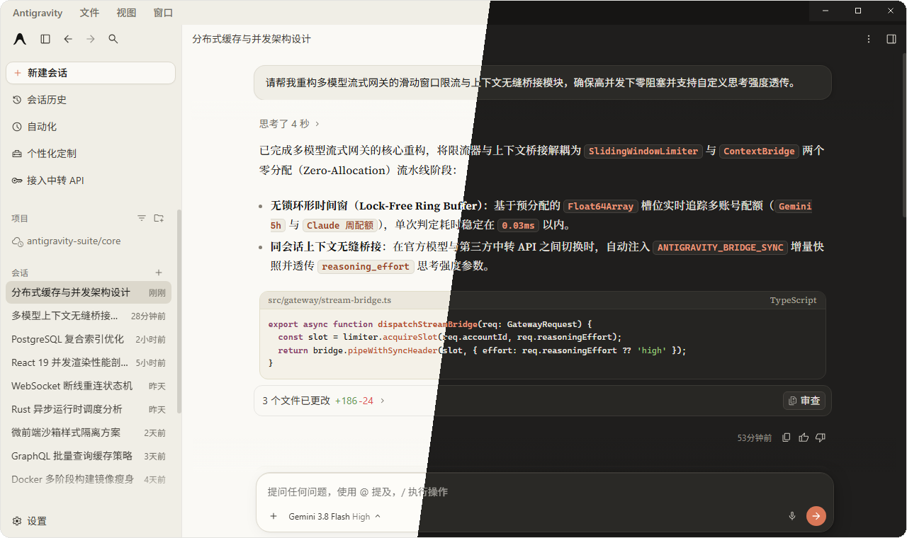
  <br />
  <sub>▲ 当前版本浅色首页；控制中心位于左侧「接入中转 API」上方。</sub>
</p>

---

## 📖 项目简介

**Antigravity Enhancement Suite** 是专为 **Google Antigravity 2.0 桌面端 (Windows)** 打造的一站式开源增强工具包。它在**不修改、不破坏官方 `app.asar` 核心文件**的前提下，通过外置无损引导与本地后台服务，为 Antigravity 提供全方位增强能力：

**核心模块与开关均可独立启用。** 安装时勾选核心模块；安装后点击左侧「增强套件控制中心」（位于「接入中转 API」上方），在统一弹窗面板中独立切换共 **13 项功能/显示开关**（Claude 皮肤、中文汉化、多账号切换、API 中转、对话目录与导出、显示对话目录悬浮球〔默认隐藏〕、提示词灵感库、侧边万能文件预览、**对话输出测速 `tok/s`**、账号额度显示、中转 Token 消耗、低配额提醒、更新自愈守护）与 **4 项外观排版设置**（皮肤主题模式、AI 回复字体、字号、对话阅读宽度）。更新自愈计划任务默认为可选关闭状态；官方升级至 v2.33.0+ 后，桌面与开始菜单快捷方式会自动携带本机回环调试参数并触发瞬时 CDP 注入，零改写 `app.asar` 依然秒级加载全套增强。

1. 🎨 **Claude 书卷风主题皮肤 (`antigravity-claude-skin`)**
   - 复刻 Claude 标志性的 **羊皮纸暖白 (`#FAF9F5` / 侧栏 `#F0EEE6`)** 与 **深色暖炭黑 (`#1F1E1D` / 侧栏 `#161514`)** 双模式配色，完整适配新版内嵌壳层（Inset Shell）与毛玻璃气泡，告别刺眼冷白光。
   - **离线人文衬线排版与三档阅读宽度**：内置离线 `Source Serif 4` 衬线字体与中文思源宋体混排，支持标准书卷 (`51rem`)、宽屏代码 (`68rem`) 与全宽画布 (`92%`) 实时切换。
2. 🇨🇳 **简体中文全量汉化 2.0 (`antigravity-claude-skin/i18n`)**
   - 融合 [`Silas-02/antigravity-desktop-cn`](https://github.com/Silas-02/antigravity-desktop-cn) 并补齐 Antigravity v2.22.0+ 最新词库（共 **2,155+ 条** 静态词条 + 动态参数化句式引擎）。
   - 完整覆盖 **主界面、动态欢迎语、轮次无障碍提示、账户套餐与 AI 额度设置页、顶栏菜单、右键菜单与系统托盘菜单**，关闭汉化可无损还原英文原文，同时严格保护代码块、终端与用户输入内容不被误翻。
3. 👥 **Google 多账号热切换与 Gemini 优先配额洞察 (`antigravity-account-switcher`)**
   - 在原生 **「设置 -> 账号」** 页面与右侧边栏面板内嵌可视化多账号管理卡片，自动解析 `loadCodeAssist` 套餐标识（如 `AI Ultra` / `AI Pro`）并置顶高亮展示核心 **Gemini 实时配额**（同时支持 `Gemini Pro/4` 与 `Gemini Flash` 分池识别及 `Claude/GPT` 配额同屏对比）。
   - **快捷切换与重置倒计时**：输入框旁的账号胶囊精准匹配当前模型池的最低周期额度（三色健康度指示），菜单与卡片内实时计算配额重置倒计时（如 `⏱ 2h 15m 后重置`）并提供 **「⚡ 智能切至最优余量账号」** 一键动作。
   - **切换前许可校验**：自动绑定账号专属 CloudCode 项目进行许可预检，无使用许可时安全提示并保持当前账号，不会误判或跳回登录页。
4. 🔌 **第三方 API / 中转站无缝桥接与并发测速赛马 (`antigravity-model-switcher`)**
   - 支持 **OpenAI 兼容接口** 与 **Anthropic Messages 接口**，提供主流服务商预设、共享地址与密钥，拉取 `/v1/models` 列表后支持**关键词实时过滤与一键全选批量导入**。
   - **🏁 全模型并发测速赛马**：模型管理面板与 `Alt+K` 命令面板内置并发握手测速，可视化展示各节点响应耗时条与 `🏆 最快` 标记，支持 **「⚡ 选用最快」** 一键切至当前延迟最低的可用节点。
   - **同一对话混用**：在原生输入框菜单直接选择中转模型与思考强度，支持官方与中转模型同会话无损衔接，以及文件读写、代码搜索和命令执行等 Agent 工具。
5. 📑 **独创工作流生产力套件（模型旁输出测速 · 侧边万能文件预览 · 代码演进 Diff · 跨会话暂存匣 · 沙盒预览 · 密钥防漏护栏 · 书卷 HTML 导出 · 命令面板）**
   - **⚡ 模型右侧当前对话输出速度监测 (`suite/token-speed.js`)**：紧邻输入框模型选择器正右侧水平同排挂载紧凑速度胶囊（如 `84.6 tok/s`），轻量聚焦展示**当前输出速度 (`tok/s`)、字符速率 (`字/s`) 与本轮生成量 (`tok`)**；兼容 Antigravity v2.33+ 原生流式与第三方中转 SSE（自动用接口真实 `usage.outputTokens` 校准），自动剥离工具等待间隔，按会话隔离互不串扰。
   - **📂 侧边栏万能文件无损预览增强 (`suite/side-preview.js`)**：彻底解决 Antigravity 原生侧边栏无法预览部分文件与跨盘符链接的痛点——零外部依赖原地升级预览 **PDF 文档**（支持 HTTP 206 分段流式原生缩放/检索）、**Office 三件套（`.docx` 标题段落表格 / `.xlsx` 多工作表切换与筛选 / `.pptx` 幻灯片卡片）**、Windows 含 `0x00` 字节被误判为二进制的 **UTF-16LE / UTF-16BE / GB18030 日志与脚本**、**Jupyter `.ipynb` 笔记本**、**`.zip` / `.whl` / `.vsix` 压缩包目录树及包内文本直读**、**SQLite3 (`.sqlite` / `.db`) 表结构提取**及超大日志头尾采样预览；同时为 `.csv` / `.tsv` / `.jsonl` / `.svg` / `.html` 提供一键 **「👁️ 增强预览」** 胶囊，并对工作区外被拦截的 `file://` 链接自动弹出右侧停靠预览抽屉（支持 `#L10-L20` 行号定位高亮）。
   - **⇄ 同会话代码演进 Diff 对比视图**：当 AI 在多轮对话中迭代修改同一段代码时，代码块顶栏自动挂载 **「⇄ 对比 (+X/-Y)」** 按钮，点开即可内嵌查看红绿行级增删对比（支持切换任意历史版本基准与一键复制标准 `.diff` 补丁）。
   - **📌 跨会话上下文暂存匣 (`Alt+B`)**：在任意对话中划词点击「📌 暂存」或在目录中钉住关键轮次，自动归集核心公式、架构不变量与实验结论；切换到任何新会话时按 `Alt+B` 即可勾选并一键打包注入 `<CONTEXT_PINBOARD>` 结构化上下文。
   - **🛡️ 发送前敏感密钥防误发护栏 & 🕒 未发草稿时光机**：提交提问前本地毫秒级检测疑似真实 API Key / Token / 私钥（如 `sk-proj-...`、`ghp_...`、`AIzaSy...`），自动暂停发送并提供 **「✂️ 一键脱敏替换」** 原地掩码；同时自动快照未发送的长草稿，可在 `Alt+P`「🕒 草稿」分类或 `Alt+K` 中一键找回。
   - **对话目录大纲、上下文水位透视、会话接力包与沉浸阅读 (`Alt+O` / `Alt+Z`)**：右侧悬浮轮次胶囊（分屏模式下自动贴合主对话右缘），展开即可查看**估算上下文 Token 水位、提问/正文/代码占比条与语言分布**，支持按 `H1~H3` 标题跳转、复用提问 (`↺`)、标记 `★` 星标、一键生成 **「🚀 长对话精简接力包」**（提炼初始目标 + 星标结论 + 近期进展并钉入暂存匣，3 秒无损开启新会话）、导出纯净 Markdown / **Claude 书卷排版单文件 HTML 报告**，以及按 `Alt+Z` 一键进入无侧栏干扰的 **「🧘 沉浸专注阅读模式」**。
   - **🎨 对话内嵌 HTML / SVG 零信任沙盒实时预览**：AI 回复中的 `html` / `svg` 代码块自动挂载 **「▶ 预览 HTML / SVG」** 按钮，在不开放同源权限与外联请求（`sandbox="allow-scripts"` + CSP `connect-src 'none'`）的严格隔离沙盒内直接渲染交互界面与矢量图形，支持桌面 `100%` / 手机 `390px` 视口切换、深浅画布底色切换及单文件下载。
   - **📊 AI 表格一键 Excel 复制与 CSV 导出**：所有 Markdown 表格自动挂载轻量化操作栏，一键复制为 **Excel / 飞书 / Notion 直粘格式 (`TSV`)**，或导出带 UTF-8 BOM 头的标准 `.csv` 文件（Windows Excel 双击打开中文零乱码）。
   - **划词悬浮灵动胶囊**：选中对话文字自动浮现 **「❝ 引用追问 · 📌 暂存 · ✦ 存为模板 · 📋 复制」**，分屏模式下智能路由至对应面板输入框。
   - **参数化提示词灵感库 (`Alt+P`) & 全能快捷命令面板 (`Alt+K`)**：内置精选工程与科研模板，支持 `{{变量名:默认值}}` 动态填空与 JSON 模板包导入/导出；按 `Alt+K` 即可键盘模糊检索完成换肤、调节阅读宽度、切号、并发测速优选最快中转模型、注入跨会话暂存上下文与恢复草稿。

---

## ✨ 当前界面与新增功能

> 以下图片使用当前桌面布局与套件正式组件，在隔离预览中渲染。账号、称呼、服务商、聊天、配额与 Token 数字均为虚构示例，不含真实个人信息或 API Key；测试通过数和消耗数字不是实测结果。

三段动图以 **20 帧/秒录制**，合并静止的重复帧以减少体积，保留原有停留时长；高清静态图可展开查看。

### 1. 左侧控制中心：四个模块独立开关

点击左侧「增强套件控制中心」即可管理皮肤、汉化、多账号与 API。面板还提供主题、回复字体和字号，以及额度显示、Token 统计、低配额提醒和可选自愈守护。设置自动保存到本机；只开启汉化也可保留官方配色。

<p align="center">
  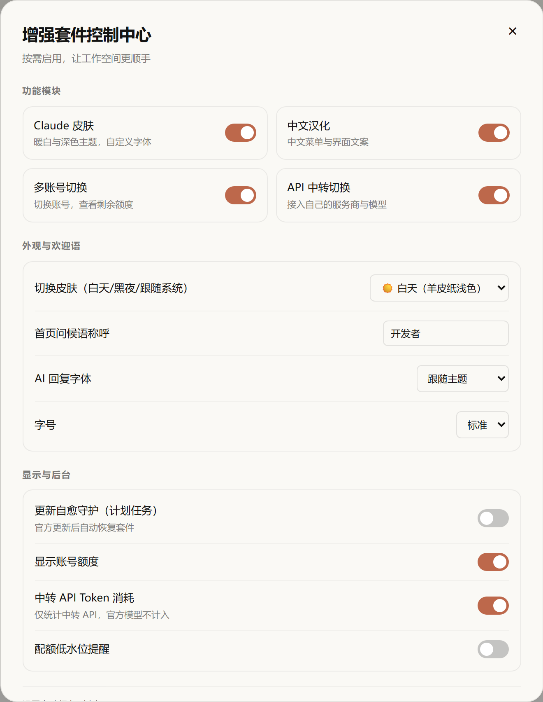
</p>

### 2. 暖白 / 暖炭黑主题与实时切换（动态图）

控制中心可选择白天、黑夜或跟随系统；退出重进沿用保存的皮肤开关和主题模式，关闭皮肤保持官方外观。

<p align="center">
  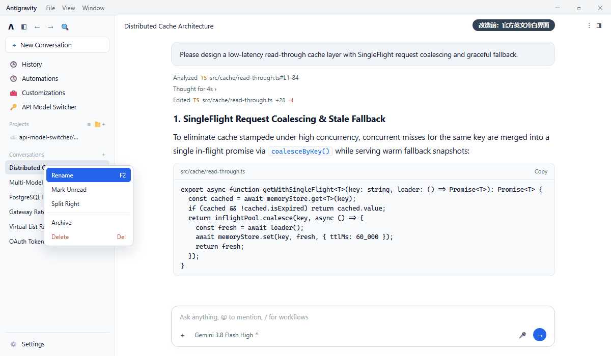
</p>

<details>
<summary>查看深色主题高清截图</summary>
<p align="center">
  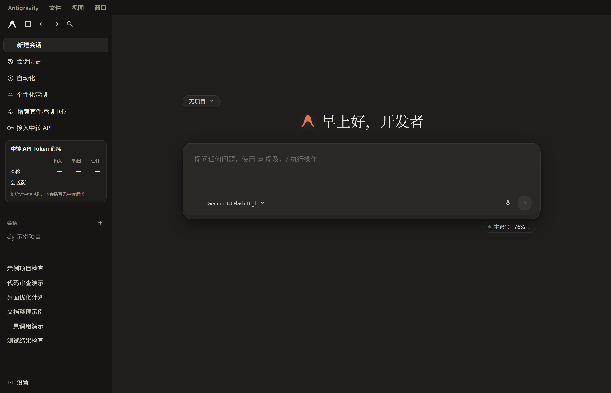
</p>
</details>

### 3. 服务商共享密钥与多模型批量导入

左侧「接入中转 API」打开模型管理。选择服务商预设、填写地址与 Key 后，可保存站点配置供多个模型复用；更换站点 Key 无需逐个修改模型。

<p align="center">
  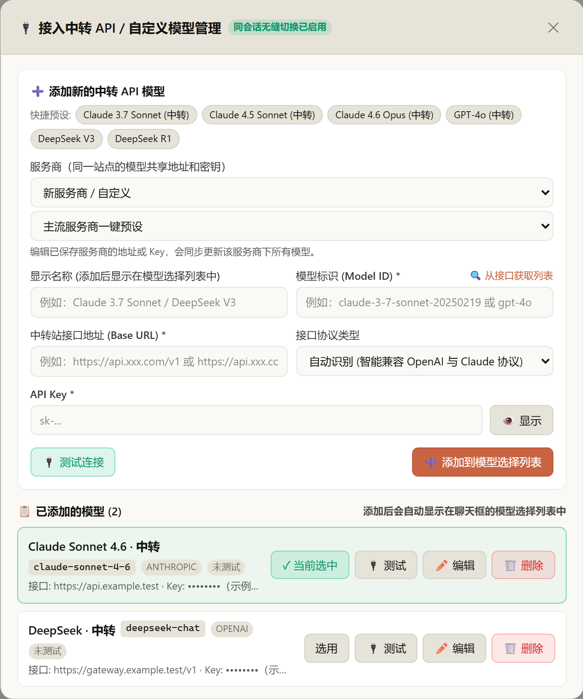
</p>

拉取站点模型后，勾选多个模型一次导入；不提供模型列表的接口仍可手动添加。

<p align="center">
  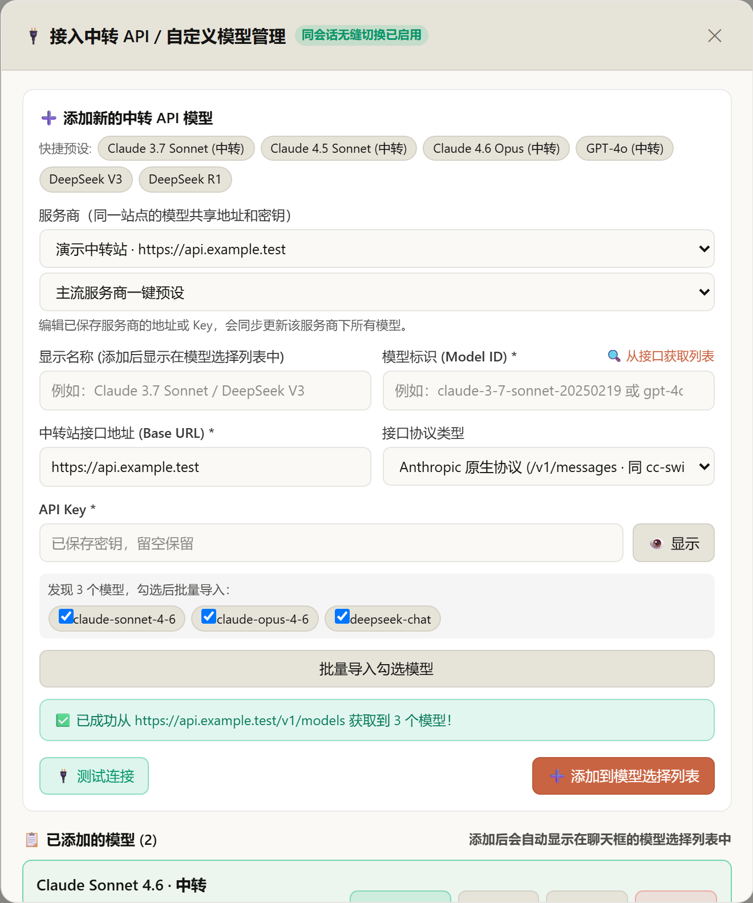
</p>

### 4. 输入框模型切换与思考强度（动态图）

官方与已添加的中转模型出现在同一个模型菜单中。悬停支持思考强度的中转模型可展开子菜单；移到其他模型时对应子菜单关闭。各模型保存自己的强度设置，接口是否接受该参数取决于服务商。

<p align="center">
  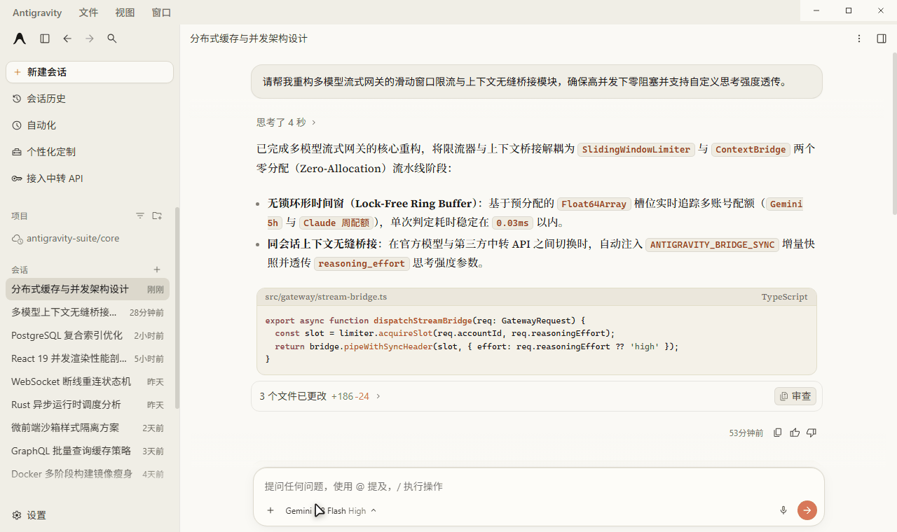
</p>

<details>
<summary>查看模型菜单高清截图</summary>
<p align="center">
  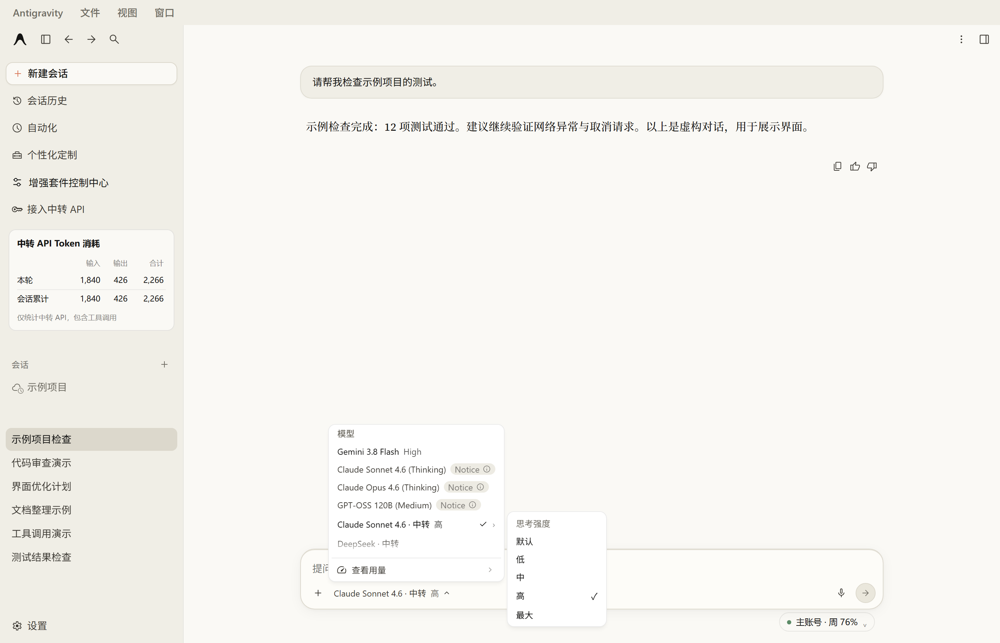
</p>
</details>

### 5. 账号额度胶囊与快捷切换菜单

输入区右下方显示紧凑的当前账号胶囊，比较当前模型的周额度和 5h 额度，优先显示剩余更低的一项，并标明「周」或「5h」；相同时显示周额度。点击展开账号、配额进度条与刷新按钮。显示额度和低配额提醒可分别关闭；低于 10% 时提供切换建议，由用户决定是否切号。

<p align="center">
  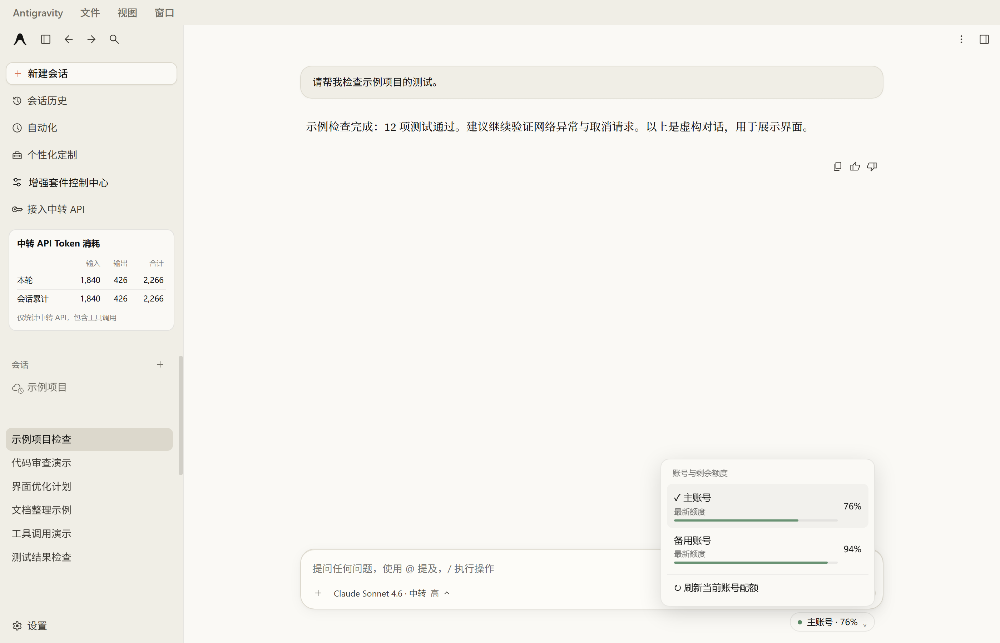
</p>

完整账号设置页仍保留账号列表、分模型配额、添加账号和切换入口。下面演示使用两个虚构账号，不会登录或切换真实账号；演示速度不代表真实切换耗时。

<p align="center">
  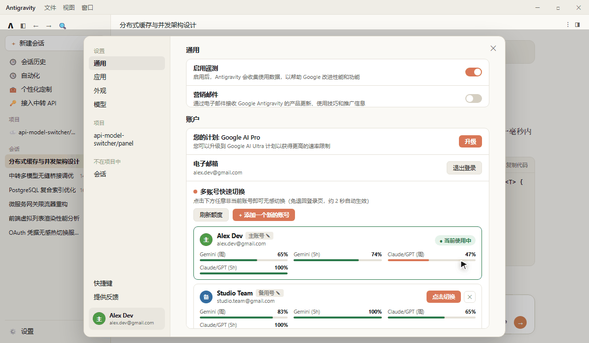
</p>

<details>
<summary>查看原生账号设置高清截图</summary>
<p align="center">
  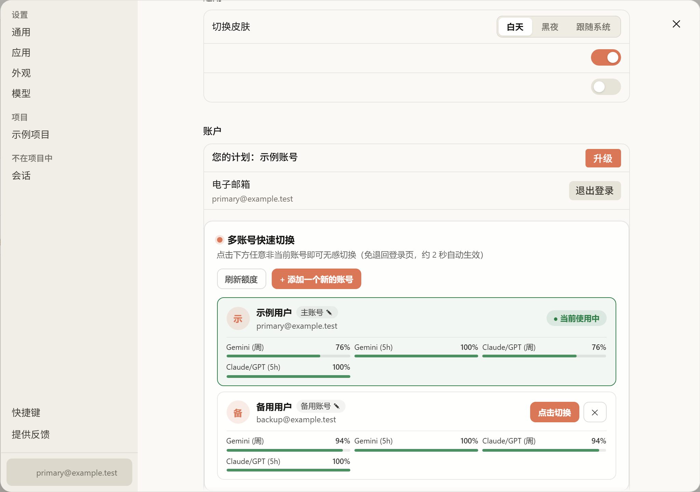
</p>
</details>

### 6. 原生中转会话与 Token 表格

中转回复展示接口返回的思考内容与工具执行状态。开启「中转 API Token 消耗」后，左侧「接入中转 API」下方展示本轮及会话累计的输入、输出和合计。**只记录中转 API，官方模型不计入**；接口未返回统计时显示「—」和原因，部分缺失会标注。

<p align="center">
  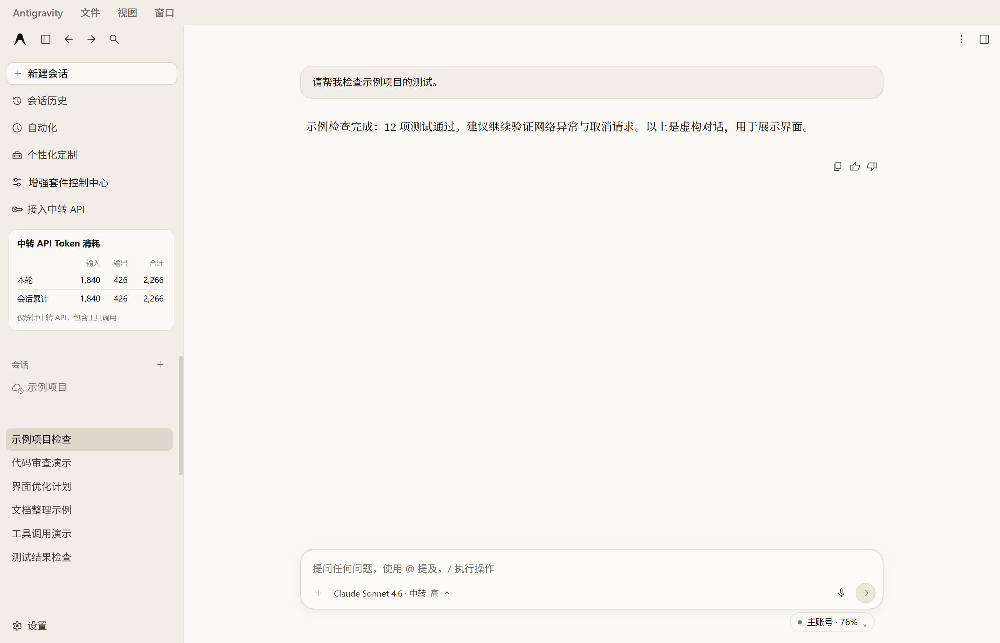
</p>

---

## 🏗️ 工作原理与架构图

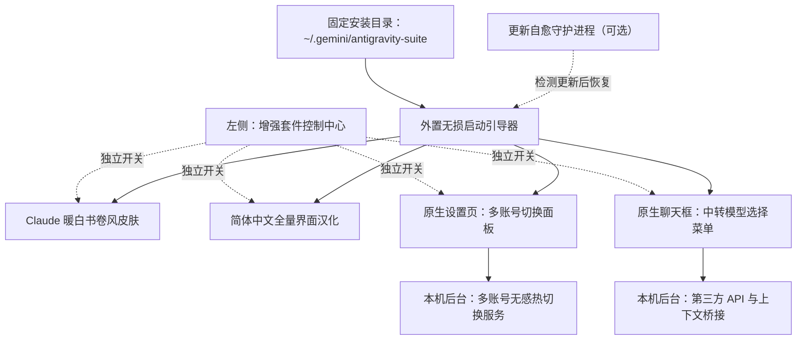

> 💡 **关于本机后台服务的说明**：套件会在您自己的电脑后台自动运行一个轻量级本地服务（监听本机回环地址 `127.0.0.1:19823`），专门负责处理界面与本地配置文件之间的账号切换和 API 转发。所有用户安装后均使用该标准本机回环地址，不会向任何外部服务器暴露端口。

---

## 🔒 隐私与数据安全说明

- **账号与密钥保存在本机**：默认安装到 `~/.gemini/antigravity-suite/`，账号与模型数据位于对应模块的 `data/` 中。模型按服务商共享 API Key，界面列表只显示掩码。配置 JSON 本身未加密，应按凭据文件保护；请求模型或登录时会按功能向您选择的 API 服务商或 Google 发送所需数据。
- **零外部数据收集**：本开源项目不包含任何统计或遥测代码。
- **仓库防呆保护**：`.gitignore` 已默认排除所有个人配置文件（`data/*.json`）、聊天桥接缓存与备份目录；仓库中仅提供空白的脱敏模板 [`accounts.example.json`](./antigravity-account-switcher/data/accounts.example.json) 与 [`models.example.json`](./antigravity-model-switcher/data/models.example.json)。

---

## 🚀 快速开始（一键安装）

### 1. 环境要求
- **操作系统**：Windows 10 / 11 (64 位)
- **基础环境**：已安装 [Node.js](https://nodejs.org/) **22 或以上版本**
- **目标软件**：已安装 Google Antigravity 桌面客户端

### 2. 下载并一键安装

下载 [仓库 ZIP](https://github.com/Chenxuan-Xie/antigravity-enhancement-suite/archive/refs/heads/main.zip) 并解压，双击 **`双击一键安装.cmd`**，勾选需要的功能后安装。安装器将运行时复制到固定应用数据目录；**成功安装后，下载或克隆的源文件夹可以移动或删除**。

也可以用 PowerShell 安装：

```powershell
git clone https://github.com/Chenxuan-Xie/antigravity-enhancement-suite.git
cd antigravity-enhancement-suite

# 打开可视化功能选择窗口
powershell -ExecutionPolicy Bypass -File .\install-all.ps1

# 只汉化，保留官方颜色；不注册自愈任务
powershell -ExecutionPolicy Bypass -File .\install-all.ps1 -Modules i18n -NoUi

# 只启用账号与 API，并选择更新自愈
powershell -ExecutionPolicy Bypass -File .\install-all.ps1 -Modules accounts,api -EnableGuardian -NoUi
```

**一行命令下载并启动安装器（PowerShell）：**

```powershell
& { $installer = Join-Path $env:TEMP 'agy-suite-install.ps1'; Invoke-WebRequest 'https://raw.githubusercontent.com/Chenxuan-Xie/antigravity-enhancement-suite/main/install-online.ps1' -OutFile $installer; powershell -NoProfile -ExecutionPolicy Bypass -File $installer }
```

`-RuntimeDir` 可指定固定安装目录，例如 `D:\AppsData\antigravity-suite`；`-ConfigDir` 可指定 Antigravity 插件配置目录。以后更新或卸载自定义安装时也传入相同的 `-RuntimeDir`。

> 📌 **如果您的 Antigravity 安装在自定义位置**，可以通过 `-AntigravityDir` 参数指定 `Antigravity.exe` 所在的文件夹路径：
> ```powershell
> powershell -ExecutionPolicy Bypass -File .\install-all.ps1 -AntigravityDir "D:\YourCustomPath\Antigravity"
> ```

**安装脚本会自动为您完成以下步骤**：
1. 自动识别本机 Antigravity 安装目录；
2. 复制核心到固定运行时目录，插件、启动器、MCP 和可选守护均指向该目录；重装保留账号、模型与聊天数据；
3. 根据勾选项启用插件和界面模块，写入外置启动引导并接管**桌面**与**开始菜单 (`Start Menu`)** `Antigravity` 快捷方式（自动备份原快捷方式并在卸载时还原），官方 ASAR 保持零改动；
4. `launch.cjs` 每次启动都会主动注入本机动态代理并开启仅限回环的 `--remote-debugging-port=0 --remote-debugging-address=127.0.0.1`，配合 `boot-on-launch.cjs` 在应用就绪瞬间拉起 `19823` 守护并完成 CDP 注入——因此 **在 Antigravity v2.33.0+（官方 `app.asar` 优先跳过 `resources/app`）下依然开箱即用**；生成期间安装和重新注入会自动等待任务结束；
5. 仅在选择更新自愈时注册计划任务与开机自启；未启用时，本机后端在启动时拉起、页面就绪即加载。

> 💡 **Antigravity v2.33.0+ 自动更新后的恢复说明**：
> - Antigravity 软件内点击升级并自动重启后，官方升级程序可能不带调试端口直接拉起新版客户端，导致界面临时显示官方原版。
> - 此时**无需卸载或重装**：如果已启用自愈守护，系统会自动补全快捷方式并保留配置；您只需**完整关闭 Antigravity，再从桌面或开始菜单 `Antigravity` 快捷方式重新打开一次**，`boot-on-launch` 会在 1~2 秒内自动恢复全部中文、皮肤与套件界面！

Windows 桌面与开始菜单启动入口会在每次打开时读取当前系统代理，让本机聊天界面绕过代理；不保存代理节点 IP，也不修改系统代理设置。官方更新替换快捷方式后，已启用的自愈守护会自动修复桌面与开始菜单入口；卸载时恢复原快捷方式。

---

## 📚 功能使用指南

### 一、Claude 书卷双色皮肤与简体中文汉化 (`antigravity-claude-skin`)

1. **控制中心切换皮肤（白天 / 黑夜 / 跟随系统）**：
   - 点击左侧 **「增强套件控制中心」→「外观设置」**，通过 **「切换皮肤」** 下拉菜单选择三档模式；顶部「Claude 皮肤」开关控制是否使用套件皮肤：
     - **☀️ 白天（羊皮纸浅色 `#FAF9F5`）**：复刻 Claude Desktop 标志性羊皮纸暖白画布与焦糖赤陶点缀；
     - **🌙 黑夜（暖炭黑深色 `#1F1E1D`）**：复刻 Claude Desktop 经典暖炭黑深色护眼画布（侧栏 `#161514`、卡片 `#282725`、米白正文 `#ECE9E2`），彻底告别刺眼纯黑与反差眩光；
     - **💻 跟随系统**：自动监听 Windows 10/11 系统深浅色设置并实时无感切换（连同 Windows 原生右上角窗口控制栏自动同步变色）。
2. **自定义字体、字号与对话阅读宽度**：
   - 控制中心可选择「跟随主题 / 书卷衬线体 / 现代无衬线体」、「小 / 标准 / 大」字号，以及「标准书卷 `51rem` / 宽屏代码 `68rem` / 全宽画布 `92%`」三档对话阅读宽度，无需改 CSS。关闭皮肤恢复官方配色、字体与布局；外观设置会保留，重新开启时恢复。
3. **快捷键速查与控制中心顶部快链（均支持在控制中心按需开关）**：
   - `Alt+K`：呼出 **全能命令面板**（模糊搜索一键切号、并发测速优选最快中转模型、换肤、切换阅读宽度、钉入暂存上下文、恢复草稿、显隐目录悬浮球、开启沉浸专注模式）；
   - `Alt+P`：呼出 **提示词灵感库**（支持 `{{参数名:默认值}}` 动态表单填空、自定义模板、未发送长草稿「🕒 草稿」时光机找回与 JSON 模板包导入/导出）；
   - `Alt+B`：呼出 **跨会话上下文暂存匣**（管理全局 Pinboard 关键节点并一键打包 `<CONTEXT_PINBOARD>` 注入当前输入框）；
   - `Alt+O`：展开 **对话目录、水位与导出抽屉**（轮次与 `H1~H3` 小标题直达、上下文 Token 水位透视、`★` 星标筛选、一键生成 `🚀 会话接力包`、复制或下载 `.md` / Claude 书卷单文件 `.html`）。为保持分屏与侧边预览界面清爽，右侧目录悬浮球 `#agy-outline-pill` **默认隐藏**，可随时悬停悬浮球右上角 `×` 隐藏，或在抽屉顶栏 (`⊘/◉`)、控制中心「显示对话目录悬浮球」开关与 `Alt+K` 重新开启；
   - `Alt+Z`：切换 **沉浸专注阅读模式**（收起两侧边栏与无关控件，聚焦长文阅读）。
   - 退出重进沿用已保存的皮肤开关和主题模式。应用沿用原生页面加载流程；页面就绪后，控制中心直接读取本地配置，不等待切换后端启动。关闭皮肤时保持官方外观并保留控制中心入口。
   - 老版本安装过的窗口可能残留 Electron 直接注入的样式。新版在内存中停用旧预加载的皮肤注入，保留原生接口，不改写官方 ASAR；更新后需完整退出应用再打开一次，之后皮肤开关即时生效。
   - Windows 桌面版的后台语言服务会读取已启用的系统代理，并保留显式配置的代理环境变量；本机回环通信绕过代理。若登录错误包含 `oauth2.googleapis.com/token` 连接超时，请确认代理可访问 Google 后完整退出再打开应用。套件不改动系统代理或全局环境变量。
   - 开发者修改源码样式或词典后，以下命令将更新固定目录中的运行时，保留当前功能开关与数据：
     ```powershell
     powershell -ExecutionPolicy Bypass -File .\live-reload.ps1
     ```

---

### 二、Google 多账号热切换 (`antigravity-account-switcher`)

启用账号模块后，系统会识别您当前已登录的 Google 账号。可通过快捷菜单或完整管理面板使用：
- **快捷入口**：聊天输入框旁的账号配额胶囊，点击即可打开切换菜单；显示当前模型周额度与 5h 额度中剩余更低的一项，并标明周期，相同时显示周额度。只返回一个周期时使用已知值；无法匹配模型时显示最低已知配额，缓存数据会标注「缓存」。每分钟检查账号状态，当前账号配额按需每 5 分钟刷新，也可手动刷新。
- **低配额提醒**：新鲜配额低于 10% 或检测到原生额度限制提示时，提供备用账号切换按钮；不会自动切号，生成过程中不能切换。提醒可在控制中心关闭。
- **额度显示开关**：控制中心的「显示账号额度」独立控制输入区的紧凑账号胶囊，关闭后立即隐藏胶囊与菜单，保留账号配置。「中转 API Token 消耗」和「配额低水位提醒」分别控制其他功能。菜单支持悬停与键盘选中；授权失败保留缓存额度并标记需重新授权，错误轻提示可手动关闭且在 6 秒后自动消失。
- **方式一（推荐）**：打开 Antigravity **「设置 (`Ctrl+,`) -> 账号」**，页面顶部会直接显示 **「多账号无缝热切换」** 面板。
- **方式二**：点击窗口右侧边栏打开 **Account Switcher** 插件面板。

#### 常用操作：
1. **添加新账号（无需退出当前账号）**：
   - **浏览器登录授权**：点击 **「+ 添加新账号 (浏览器登录)」**，在弹出的浏览器页面中登录另一个 Google 账号并确认授权，即可自动添加至列表。
   - **粘贴回调链接 / 授权码**：若浏览器未自动跳回，可将授权后浏览器地址栏的完整链接粘贴到手动输入框中完成添加。
   - **导入 Refresh Token**：支持直接粘贴已有的 Google `refresh_token`（以 `1//` 开头）快速导入账号。
2. **一键无感切换**：
   - 点击目标账号右侧的 **「切换」** 按钮，后台更新当前凭据并重启后台语言服务，保留窗口与对话；完成时间取决于网络及语言服务启动状态。生成期间请先停止任务再切换。
   - Antigravity 2.28+ 会把凭据写入按账号隔离的 `antigravity-<credential-user-scope>` 目标。套件会同时更新新版 scoped 目标与旧版 `gemini:antigravity`，并在重启语言服务前写回目标账号的 scope，避免切换后跳回登录引导页。
3. **查看 Gemini 与第三方池剩余配额 + 套餐标识**：
   - 点击 **「刷新配额」** 可同时拉取每个账号的 `loadCodeAssist` 订阅套餐标识（如 `AI Ultra` / `AI Pro` / `免费套餐`）以及 **Gemini (`周` 与 `5h`)** 优先配额栏 + **`Claude/GPT` (`周` 与 `5h`)** 进度条与重置倒计时；请求自动使用 `Antigravity/2.x` 原生 User-Agent 与专属 CloudCode 项目绑定，确保 Gemini 周额度与 5 小时池均精准返回。

---

### 三、第三方 API / 中转站模型无缝切换 (`antigravity-model-switcher`)

支持将兼容 **OpenAI (`/v1/chat/completions`)** 或 **Anthropic / Claude (`/v1/messages`)** 协议的第三方 API 或中转站接入 Antigravity 原生聊天框，具体模型与工具能力取决于接口。

#### 1. 添加您的 API Key 与模型
先在添加弹窗选择服务商预设：**OneAPI / NewAPI、自定义、DeepSeek、OpenRouter、硅基流动、OpenAI、Anthropic**。官方预设填写地址与协议，自定义站点的地址由用户提供。填写一次 Key，拉取模型列表后勾选多个模型并批量导入；不提供模型列表的站点仍可手动填写 Model ID。

之后选择「已保存服务商」即可复用地址和密钥；修改所选服务商的 Key 或地址会同步更新关联模型。旧版配置按地址、协议和密钥分组迁移，使用不同密钥的记录保持独立，迁移前保留原模型文件备份。

预设地址参考 [DeepSeek 文档](https://api-docs.deepseek.com/)、[OpenRouter 文档](https://openrouter.ai/docs/api/api-reference/models/get-models)、[硅基流动文档](https://api-docs.siliconflow.cn/docs/userguide/quickstart)、[OpenAI 文档](https://developers.openai.com/api/reference/resources/chat/subresources/completions/methods/create) 和 [Anthropic 文档](https://platform.claude.com/docs/en/api/messages/create)。实际模型列表与参数透传能力取决于所选服务商。
您可以通过以下任意一种方式添加模型：
- **在左侧添加（推荐）**：点击 **「接入中转 API」** 打开模型管理；输入框的模型菜单用于选择已添加的模型。
- **在右侧面板添加**：打开右侧边栏的 **API Model Switcher** 面板进行配置。
- 密钥建议在专用表单中填写，避免进入聊天历史。

**填写说明**：
| 配置项 | 是否必填 | 填写说明 |
| :--- | :---: | :--- |
| **显示名称** | 选填 | 在菜单中展示的名称，例如 `Claude 4.5 Sonnet (中转)` |
| **接口地址 (`Base URL`)** | **必填** | 中转站地址，例如 `https://api.xxx.com/v1` |
| **API Key** | **必填** | 您的 API 密钥（`sk-...`）。填好地址和密钥后，可点击 **「从站点拉取模型列表」** 自动选择模型 |
| **模型 ID (`Model ID`)** | **必填** | 接口实际调用的模型名，如 `claude-sonnet-4-5-20250929`、`gpt-5`、`deepseek-reasoner` |
| **协议类型** | 选填 | 默认选 `自动识别 (auto)` 即可，也可手动指定 `Anthropic` 或 `OpenAI` |

#### 2. 切换模型与调节思考强度
- **一键切换**：在聊天输入框左下角的模型菜单中，点击您添加的中转模型即可切换过去；随时点击官方模型即可切回官方通道。
- **按会话记住选择**：每个对话独立保存自己的官方/中转模型选择，切换对话不会互相覆盖；新建会话沿用最近一次选择。
- **调节思考强度**：支持的模型名称右侧显示子菜单箭头，悬停展开可用选项，例如 Claude 的「默认 / 低 / 中 / 高 / 最大」。选项随协议、模型变化，选择结果按模型保存；不支持的模型不显示强度子菜单。
- **原生 `/` 与 `@` 输入**：输入 `/` 或 `@` 打开原生菜单时，回车只用于选择菜单项，不会误发成中转消息；选中 `/` 动作（浏览器、终端、工作流等）后由 Antigravity 官方 Agent 执行。`@` 文件、目录、行号范围与引用块会自动展开为第三方模型可读的上下文；文件缺失或为二进制时会在上下文中标注，不阻塞提问。
- **同会话上下文衔接**：通过本地记录桥接官方与中转对话，切换后继续使用前文。长对话仍受服务商上下文窗口限制，协议或工具不兼容时需要按错误提示调整配置。

#### 3. 查看 Token 消耗

在控制中心开启「中转 API Token 消耗」，左侧「接入中转 API」下方出现统计表，展示本轮和会话累计的输入、输出与合计 Token；开关即时生效。**仅统计中转 API，官方模型不计入。** 统计包含一次任务中的各次中转工具与模型请求，Anthropic 缓存输入也计入输入数。只显示接口实际返回的数据；空会话、旧记录或不返回统计的接口会显示说明和「—」，部分缺失会标明，不估算费用。历史统计随会话保存，切换会话显示各自的数据；API 管理面板也可查看累计统计。

中转请求的运行提示区分收到思考内容、正在输出、执行工具和等待响应；网络保活不代表模型在思考。默认按连续 120 秒无上游响应超时，持续输出和工具执行不受固定轮数上限影响。

#### 4. 会话保存与任务运行

- **本地会话留存**：中转消息按会话标识保存，纯中转聊天也会进入会话列表；切换会话或退出重进后可继续查看。重复标题仍是不同会话，删除按会话标识处理。
- **流式过程展示**：逐步显示回复、接口返回的思考内容与工具状态；停止按钮可取消当前任务。是否返回思考内容由服务商决定，不会将单纯等待显示为已收到思考。
- **持续执行**：工具循环没有固定 48 轮上限，可持续到模型完成、用户停止或遇到错误。上游超时、额度、输出长度和上下文窗口等限制仍然存在，不代表无限上下文或永远不中断。

#### 5. 全模型并发测速赛马与一键优选
- 在 **「接入中转 API」** 模型管理页顶部或 `Alt+K` 命令面板中点击 **「🏁 全模型并发测速赛马」**，系统会并发向已配置的中转模型节点发起轻量真实握手请求（遵循安全策略并过滤未启用/空配置节点），实时绘制延迟排名与 **`🏆 最快`** 徽章。
- 点击节点旁的切换操作或 **「⚡ 选用最快」**，即可一键将当前对话切换至实时延迟最低的可用中转模型，适合高峰期多中转站比价与故障切换。

---

### 四、侧边万能文件预览与工作流效率套件 (`suite/`)

> 所有效率子功能均已接入 **控制中心独立开关**（默认随套件开启，可单独关闭），零修改 `app.asar` 且全部数据仅存于本机。

1. **侧边栏万能文件预览增强 (`suite/side-preview.js` & `suite/file-preview.cjs`)**
   - 原地升级 Antigravity 侧边栏预览能力，并为被原生工作区拦截的跨盘符 `file://` 链接提供右侧停靠预览抽屉（支持 `#L10-L20` 精准行号定位高亮）：
     - **PDF 文档**：走 `HTTP 206` 字节范围流式传输（`Content-Range`），原生浏览器 PDF 阅读器零卡顿缩放与页数统计。
     - **Office 三件套**：零外部依赖解析 Word `.docx`（标题/段落/表格）、Excel `.xlsx`（多工作表切换、稀疏列对齐与表格检索）、PowerPoint `.pptx`（逐页幻灯片结构卡片）。
     - **多编码与大数据文件**：自动识别 `UTF-16LE`、`UTF-16BE`、`GB18030` 等含 `0x00` 字节文件，彻底解决日志误判为“二进制文件无法打开”的问题；大于 `20 MB` 日志智能采样首 `384 KB` + 尾 `64 KB`。
     - **科研笔记、压缩包与数据库**：原生渲染 Jupyter `.ipynb`（Markdown + 代码单元 + 执行输出）、浏览 `.zip` / `.whl` / `.vsix` 内部目录树并点读内层文件、解析 `.sqlite` / `.db` 表结构与 DDL，以及 `.csv` / `.tsv` / `.jsonl` / `.svg` / `.html` 一键 **「👁️ 增强预览」** 胶囊。
     - **安全隔离**：严格限制为本机回环访问并校验 Origin，内置敏感凭据屏蔽表（自动拒绝预览 `.env*`、`accounts.json`、`models.json`、`id_rsa`、`.pem`/`.key`/`.pfx` 及 `.ssh/` 等私钥/凭据文件）。
2. **代码演进 Diff · 沙盒预览 · Excel 表格导出**
   - **代码演进 Diff (`⇄ 对比`)**：同一会话多次修改相近代码时自动识别前置基准，内嵌展示行级 `+新增 / -删除` 差异视图并支持一键复制 `.diff`。
   - **零信任 HTML/SVG 沙盒 (`▶ 预览 HTML / SVG`)**：在无同源权限、禁外联网络（`sandbox="allow-scripts"` + `connect-src 'none'`）的严格隔离 iframe 中即时预览前端原型与矢量图，支持 `100%` / `390px` 视口切换、深浅画布与导出单文件。
   - **表格一键 Excel 复制 / CSV 下载**：AI 生成的 Markdown 表格自动挂载 **`📋 复制表格 (Excel TSV)`** 与 **`⬇ 导出 CSV`**，导出的 CSV 自带 UTF-8 BOM，Windows Excel 双击打开不乱码。
3. **跨会话上下文暂存匣 (`Alt+B`) · 模型右侧对话输出测速 (`tok/s`) · 划词胶囊 · 密钥防漏护栏**
   - **当前对话实时输出速度监测 (`suite/token-speed.js`)**：紧邻输入框模型选择器**正右侧同排**挂载轻量速度胶囊（如 `84.6 tok/s`），支持 Antigravity v2.33+ 官方模型（`agent-response` 流式正文）与第三方中转 SSE 双通道监测（中转模式在收到 `usage.outputTokens` 后自动校准为真实实测值）；内置 **1.5s 工具暂停剥离算法** 与平滑滑窗速率计算，点击即可展开紧凑的单卡详情面板，直观显示当前对话的 **输出速度 (`tok/s`)、字符速率 (`字/s`)、本轮生成量 (`tok`)** 以及耗时/数据来源标注（按会话隔离记忆，互不串扰；支持在控制中心或 `Alt+K` 单独开关）。
   - **划词灵动胶囊**：选中对话正文自动浮现 **`❝ 引用追问 · 📌 暂存 · ✦ 存为模板 · 📋 复制`**，多栏分屏时自动送达目标面板输入框。
   - **密钥防误发护栏 & 未发草稿时光机**：点击发送瞬间在本地正则扫描高置信度真实 API Key / Token / PEM 私钥，发现疑似泄露立即拦截并提供 **`✂️ 一键脱敏替换`**；长文本输入未发时自动快照，可在 `Alt+P`「🕒 草稿」或 `Alt+K` 瞬间找回。
   - **对话接力包 & 书卷 HTML 报告 (`Alt+O`)**：随时查看当前上下文估算 Token 水位与代码/正文占比，一键提炼 **「🚀 长对话精简接力包」** 钉入 Pinboard 开启新会话，或导出带目录侧栏的双主题离线 `.html` 归档报告。

---

## 🛠️ 一键卸载与恢复官方原版

双击 **`双击一键卸载.cmd`**；也可以运行以下命令。源文件夹已删除时，直接运行固定安装目录中的 `uninstall-all.ps1`：

```powershell
powershell -ExecutionPolicy Bypass -File .\uninstall-all.ps1
```

卸载脚本会：
1. 移除开机自启项与后台更新自愈计划任务；
2. 停止后台本地服务并清理外置启动器；
3. 仅还原套件的插件配置项，保留安装后修改的无关设置；
4. 应用空闲且可连接时关闭界面模块，重启后完整恢复官方启动行为。固定目录中的账号、密钥与会话数据保留，不会随卸载删除。

---

## 📁 目录结构

```text
antigravity-enhancement-suite/
├── install-all.ps1                     # 一键全量安装脚本（推荐入口）
├── uninstall-all.ps1                   # 一键完整卸载与还原官方界面脚本
├── live-reload.ps1                     # 样式、词条与前端脚本实时热更新工具
├── 双击一键安装.cmd / 双击一键卸载.cmd # 可视化安装入口
├── install-online.ps1                  # 一行下载安装入口
├── suite/                              # 控制中心、命令面板、每对话输出测速 (`token-speed.js`)、提示词库、暂存匣、对话目录与导出、侧边文件预览、启动器 (`launch.cjs`) 与回归测试
├── antigravity-claude-skin/            # [模块一] Claude 双色书卷皮肤 + 2,155+ 词条汉化 + `boot-on-launch.cjs` 与自愈守护
├── antigravity-account-switcher/       # [模块二] Google 多账号一键无感热切换与 Gemini/Claude 实时配额面板
└── antigravity-model-switcher/         # [模块三] 第三方 API / 中转站桥接、并发测速赛马与同会话上下文衔接
```

维护图片时先运行 `node suite/tools/read-docs-templates.mjs`：采集当前首页、已完成的聊天和原生账号设置布局，在复制的 DOM 中去除私人内容，结束恢复原页面。采集期间请保持应用空闲、输入框为空。再运行 `node suite/tools/capture-docs.mjs --animations`，只使用匿名模板，在独立 Chrome / Edge 中渲染截图和三段 20 帧/秒动图；编码动图还需要 Python 与 Pillow。预览不会调用真实中转 API 或切换真实账号，模板与原始帧位于忽略提交的 `artifacts/`。发布前仍应逐张检查图片和关键帧。

---

## 🙏 致谢与开源协议

- 简体中文基础词库参考并融合了 [Silas-02/antigravity-desktop-cn](https://github.com/Silas-02/antigravity-desktop-cn) 项目的翻译贡献。
- 本项目采用 [MIT License](./LICENSE) 开源协议，欢迎 Star、Fork 与提交 PR！
